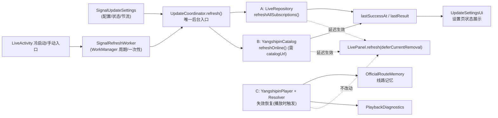
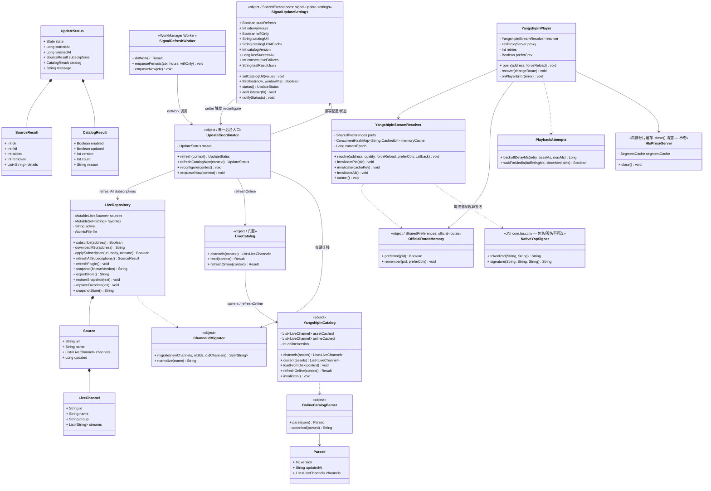
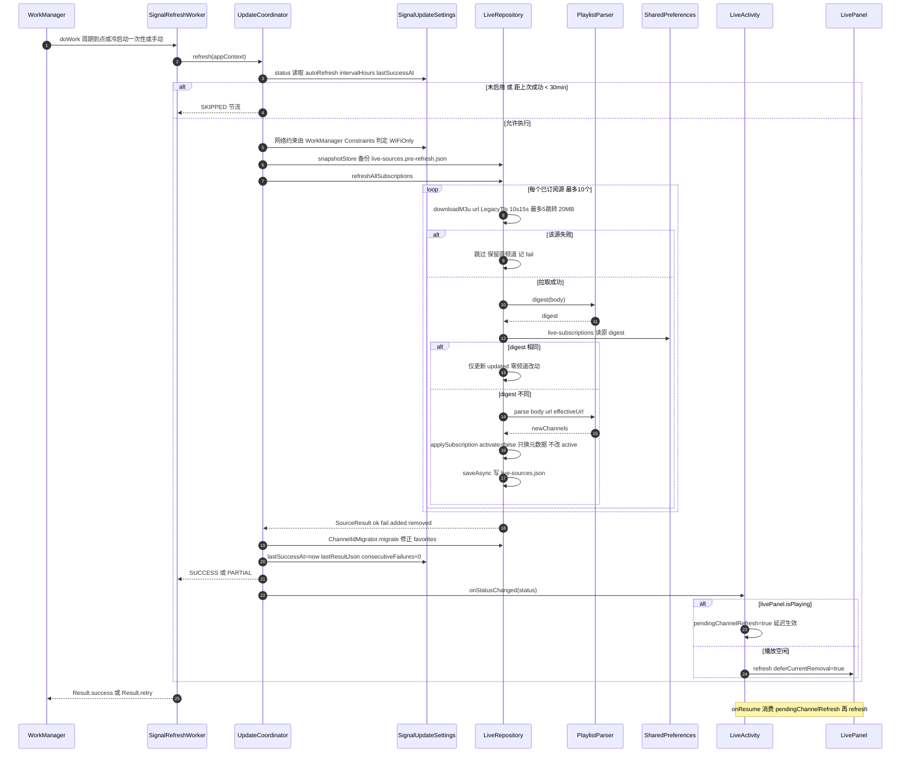
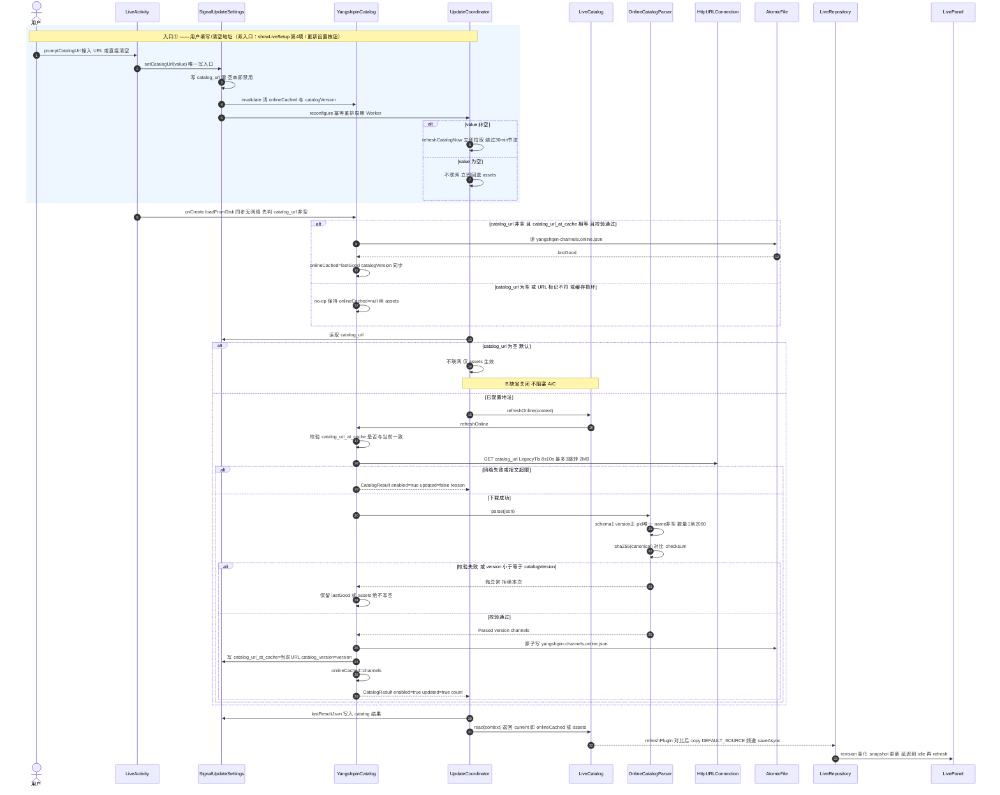
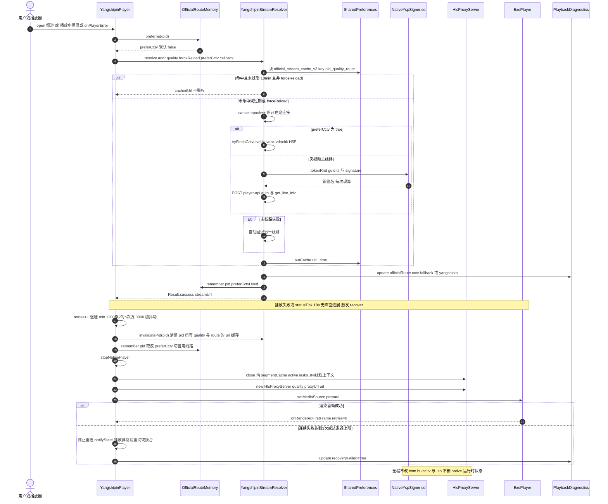
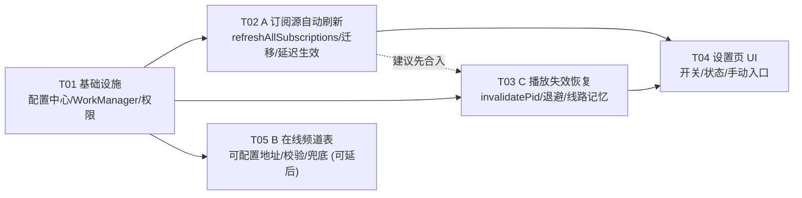

# OneTV Live 信号源自动更新 — 架构设计与任务分解

| 项目 | 内容 |
|---|---|
| 文档类型 | 增量架构设计（基于 `architecture-design.md` v1.0） |
| 版本 | **v1.1**（2026-11-16：落实 B 托管地址"预留配置项"拍板，详化 §4.3 配置规格 + 双入口 + 触发链 + 缓存一致性） |
| 架构师 | 高见远（Gao / software-architect） |
| 上游输入 | `prd-autoupdate.md`、`architecture-design.md`、`onetv-live-apk` 实际源码（已逐文件核验） |
| 目标工程 | `/Users/licheng/WorkBuddy/2026-11-16-18-40-24/onetv-live-apk` |
| 优先级 | A 订阅源自动刷新（P0） > C 播放失效自动恢复（P1） > B 内置频道表在线更新（P2，可延后） |
| 铁律 | `package com.tvbridge.app` 与 `package com.bu.cc.tv`、3 个 JNI 类签名、两份 `.so` 一字不改；`applicationId=com.onetv.live`；minSdk 19；不引入 Compose/Hilt |

---

## 0. 源码核验结论（设计基线）

> 以下均为**本次实际读源码确认**的事实，不是推测；设计严格贴合这些事实。

| 关注点 | 源码位置 | 核验结论 / 对设计的约束 |
|---|---|---|
| 订阅拉取与去重 | `LiveRepository.kt:186-212` `subscribe()` | 已实现 HTTP 拉取（≤5 次跳转、connect 10s / read 15s、≤20MB）+ `PlaylistParser.digest()` 对比 `live-subscriptions` SharedPreferences；无变化时仅刷新 `updated`。**但 `replace()`（:168-175）会把 `active` 改成被订阅的源并 `lastMessage` 改写** —— 自动刷新绝不能直接调公共 `subscribe()`，必须抽出 `activate=false` 的内部路径 |
| 订阅源上限 | `LiveRepository.kt:169` | `sources.count{it.url!=DEFAULT_SOURCE}<10`，即最多 10 个订阅源；总频道 ≤20000（:170）。沿用，不新增放宽 |
| 内置频道刷新 | `LiveRepository.kt:66-78` `refreshPlugin()` | 读 `LiveCatalog.read(context)` → `YangshipinCatalog.channels(context.assets)`（静态 assets）；仅当 `channels != capped` 时 `copy(channels=capped)` + `saveAsync()`。`LiveActivity.onCreate/onResume` 均调用（:40、:205） |
| 内置频道表 | `YangshipinCatalog.kt:17-41` | `@Volatile cached` + `invalidate()`；`channels(assets)` 解析 assets JSON，ID = `yangshipin-$pid`，按硬编码 `order` 前 20 + 其余排序。注释明确"进程运行期间不变"——B 需打破该假设，但**保留 `channels(assets)` 作为兜底与测试入口** |
| 内置表读取门面 | `LiveCatalog.kt:13-14` | `channels(context)=YangshipinCatalog.channels(context.assets)`，`read()` 包 try/catch 返回 `Result(channels,error)`。B 在此加"当前生效表"入口，保持 `read()` 不联网（防 onResume 偷跑网络） |
| 流地址缓存 | `YangshipinStreamResolver.kt:18-19,25,85-95,152-171` | 磁盘 `official_stream_cache_v3` SharedPreferences（`url_$key`/`time_$key`）+ 内存 `ConcurrentHashMap`；TTL 10min；`key="${pid}_${quality}[_cctv]"`；`forceReload=true` 已能清该 key。**C 的"清缓存"要落在这里** |
| 重新鉴权路径 | `YangshipinStreamResolver.kt:214-267` | `tryFetchYangshipinLiveUrl()` 每次调用都重新 `YangshipinApiPayload.create` → auth → JNI `tokenRnd/signature` → get_live_info。**签名每次由 so 现算，重跑该函数即"重新取签名"，无需从 so 反向提取**（回答 PRD Q6：可行） |
| 备用线路 | `YangshipinStreamResolver.kt:125-145` | `vdnx.live.cntv.cn` / `vdnxbk.live.cntv.cn`，H5E 流；`preferCctv` 决定优先级，主路失败自动回退另一路 |
| HLS 代理缓存 | `HlsProxyServer.kt:30-47,386-401` | 分片缓存 `SegmentCache` **纯内存**（6/3 条、32/16MB），`close()` 清空并取消任务；JNI CMG 运行时状态在 companion（:517-553）且每片 `restartCmgRuntime`。**无磁盘缓存**，不得删除 `.so` 或清 JNI 全局运行时 |
| 已有轻量恢复 | `YangshipinPlayer.kt:94-110,215-230` | `recover()` 已有"切线路 + `start(addr,true)`(forceReload) + 重连 2 次"，延迟为线性 `retries*1500L`；黑屏由 `statusTick`（:65-85）18s 无进展触发。C 是在此收敛，不是重写 |
| 官方线路记忆 | `YangshipinPlayer.kt:60` | `preferCctv` 仅内存，重启丢失；`PlaybackRoutes`（:17）对 `LiveCatalog.isPage` 直接 return（:17），**官方线路记忆是缺口** |
| 已有初级自动刷新 | `LivePanel.kt:326-339` `maybeAutoRefreshSubscription()` | **已存在**但受限：仅 API>23、非 lowram、每进程一次（`autoRefreshTried`）、**仅当前激活源**、阈值 12h、直接调 `subscribe()`（会切 active）。A 用统一调度器替换它 |
| 原生线路退避 | `LivePanel.kt:385-391` | `recover()` 固定 1200ms、最多 2 次；`PlaybackAttempts.kt` 无退避函数。C 加统一指数退避 |
| 收藏 ID | `PlaylistParser.kt:45` / `YangshipinCatalog.kt:35` | m3u 频道 ID = `digest("$scope:${tvg-id或name}")`，央视 = `yangshipin-$pid`；**已非数组下标**，但"改名"仍会变 ID → 需继承映射 |
| 线程工具 | `AppThreads.kt:18-29` | `state`/`boot`/`io`(cached pool)/`main`；后台任务统一投 `onIo`，禁止主线程联网/落盘 |
| 权限/构建 | `AndroidManifest.xml:9-15`、`app/build.gradle:14-21,63-74` | 7 项权限；AGP8.7.3/Kotlin2.0.21/minSdk19/targetSdk35/media3 六件套/nextlib/conscrypt/multidex；无 WorkManager |
| 菜单入口 | `LivePanel.kt:24,240-253,292` | 构造器 5 参；`action()` 生成遥控器可达按钮；`showLiveDialog(NativeUi.show)` 是统一弹窗方式 |

---

## 1. 总体方案与三项功能的交互关系

### 1.1 设计原则

1. **单一后台入口**：A 与 B 的定时任务合并为**一个** WorkManager 周期任务（`SignalRefreshWorker`），一次唤醒完成"订阅源刷新 + 频道表刷新"，避免两套闹钟互相唤醒 TV。
2. **播放与元数据解耦**：所有后台更新只改 `LiveRepository` 元数据与 `YangshipinCatalog` 内存/磁盘缓存；**不触碰**当前 `ExoPlayer`/`HlsProxyServer` 实例。列表变更延迟到 `onResume` 或播放空闲时生效；当前频道被删时"先继续播、后处理"。
3. **C 走现有恢复链收敛**：复用 `YangshipinPlayer.recover()` 与 resolver 的 forceReload/线路回退，补齐"精确清缓存 + 指数退避 + 线路记忆持久化"，不新建播放器。
4. **B 地址可配置、缺省关闭**：`catalogUrl` 默认空字符串 = 只用 assets。架构先就绪，地址后续由用户在设置页填入（或打包时用 `buildConfigField` 注入），**绝不硬编码任何假设存在的 URL**。
5. **配置与状态集中**：新增 `SignalUpdateSettings`（SharedPreferences）作为唯一配置/状态源，UI、Worker、Coordinator 只认它。
6. **JNI 零风险**：不改 `com.bu.cc.tv`、不改 `.so`、不持久化删除 native 运行时状态；所有 native 调用保留 `try/catch (LinkageError)` 惯例。

### 1.2 三者交互图



- **A→C**：订阅源刷新若删掉当前播放的自定义 m3u 频道，不立即停播；C 的恢复链继续用旧 `LiveChannel` 快照，直到用户切台/回前台。
- **B→A**：B 更新的内置表经 `LiveCatalog.read()` 进入 `LiveRepository.refreshPlugin()`，最终也是"改 DEFAULT_SOURCE 元数据"，与 A 共用延迟生效策略。
- **C 独立**：C 完全在播放链路内闭环，不依赖 A/B 是否启用；即使无网络配置也能工作。

### 1.3 关键行为约定

| 场景 | 行为 |
|---|---|
| 冷启动 | `onCreate` 完成 `LiveRepository` 后立即 `enqueuePeriodic`（幂等）+ `enqueueNow`（一次性）；并 `YangshipinCatalog.loadFromDisk`（先判 `catalog_url` 非空）；不阻塞首帧播放 |
| 填写/清空频道表地址 | 双入口（`showLiveSetup` 第 4 项 + "更新设置"按钮）都走 `promptCatalogUrl()` → `SignalUpdateSettings.setCatalogUrl()` 唯一写入口；非空则 `invalidate()` + `reconfigure()` + `refreshCatalogNow()` 立即拉取（绕过 30min 节流）；空则 `invalidate()` 后立即回退 assets、零网络 |
| 定时到点 | WorkManager 约束判定（仅WiFi/是否启用）→ `UpdateCoordinator.refresh()` → 30min 节流 → 依次刷新 A、B |
| 播放中刷新完成 | `LiveActivity` 收到状态回调，若 `livePanel?.isPlaying()==true`，置 `pendingChannelRefresh=true`；回前台/播放停止/用户切台时再调 `livePanel.refresh(deferCurrentRemoval=true)` |
| 当前频道被删 | `LivePanel.refresh(deferCurrentRemoval=true)` 保留当前 `LiveChannel` 继续播，仅标记"列表已更新"；下次切台才真正移除 |
| 失败提示 | 静默写 `lastResult` + `consecutiveFailures`；连续 ≥3 次才在设置页显示"更新异常"；播放中不弹窗 |
| 收藏迁移 | 新列表先过 `ChannelIdMigrator`：精确 ID → 首条流 URL 摘要 → 规范化名称，逐级匹配；无法映射的收藏**保留为孤儿**，不删除 |

---

## 2. 后台调度方案选型（明确推荐 + 理由 + 新增依赖/权限）

### 2.1 三方案对比

| 维度 | **WorkManager（推荐）** | AlarmManager + BroadcastReceiver | App 内 Handler 定时 |
|---|---|---|---|
| 进程被杀后仍能执行 | ✅ WorkManager 自身持久化调度，重启后自动恢复 | ✅ 但需自写 `BootReceiver` 重新 `setInexactRepeating` | ❌ 进程死即失效 |
| 设备重启后恢复 | ✅ 内部 manifest merge 自动注册 | ⚠️ 必须新增 `RECEIVE_BOOT_COMPLETED` + 自写接收器重挂闹钟 | ❌ |
| Doze / TV 休眠 | ✅ 由系统批处理延迟，符合 PRD"允许批处理延迟" | ⚠️ inexact 闹钟在 doze 下同样延迟，但要自己处理 `setAndAllowWhileIdle` 与 wake lock 释放 | ❌ 前台才跑 |
| "仅 WiFi"约束 | ✅ `Constraints.setRequiredNetworkType(UNMETERED)` 原生支持 | ⚠️ 自己用 `ConnectivityManager` 判断 + 失败重挂 | ❌ |
| 去重/周期更新配置 | ✅ `enqueueUniquePeriodicWork(..., UPDATE)` 原生幂等 + 改配置即更新 | ⚠️ 自己 cancel + re-set，易重复挂多个闹钟 | ⚠️ |
| 失败退避/重试 | ✅ `Result.retry()` + 系统退避 | ⚠️ 自己实现 | ⚠️ |
| 10s 短任务 + 不长期持锁 | ✅ Worker 内部自动管理 wake lock | ⚠️ 需 `goAsync()`+`WakeLock.acquire/release`，出错会泄漏 | ✅ |
| minSdk 19 兼容 | ✅ WorkManager 2.9.x 声明 minSdk 14（已核实 AndroidX release notes；`work-runtime-ktx:2.9.1` 为稳定版） | ✅ API19 起支持 `setInexactRepeating` | ✅ |
| 新增依赖 | ⚠️ `androidx.work:work-runtime-ktx:2.9.1`（传递引入 room-runtime/sqlite/coroutines-core 等，方法数上升；**已启用 multidex，可接受**） | ✅ 无 | ✅ 无 |
| 新增权限 | ⚠️ WorkManager manifest merge 会带入 `RECEIVE_BOOT_COMPLETED`（`WAKE_LOCK` 已有）；**不需要** `SCHEDULE_EXACT_ALARM`（我们用非精确任务） | ⚠️ 显式新增 `RECEIVE_BOOT_COMPLETED`（`WAKE_LOCK` 已有） | ✅ 无 |
| 精确闹钟权限 | 不需要（PRD 明确不用精确闹钟） | 不需要（若用 `setInexactRepeating`） | — |
| 代码量/边界情况 | 低（约 1 Worker + 1 封装） | 中高（重挂、去重、wake lock、API31+ `FLAG_IMMUTABLE`、API26+ 广播限制） | 低但**不满足需求** |

### 2.2 推荐结论

**采用 WorkManager（`androidx.work:work-runtime-ktx:2.9.1`）作为唯一后台调度器，冷启动 + 周期 + 手动三种触发都汇入同一个 `UpdateCoordinator.refresh()`。**

理由（按权重）：
1. **TV 长期开机、休眠是常态、重启频率低**：核心痛点正是"进程/设备生命周期长且不可控"。WorkManager 原生保证任务在进程死亡、重启、doze 后仍最终执行，AlarmManager 方案要把这些边界全部手写且极易出错。
2. **"仅 WiFi"开关与配置动态变更**：WorkManager 的 `Constraints` + `enqueueUniquePeriodicWork(UPDATE)` 直接表达"6/12/24h 频率 + 仅WiFi"，用户改设置时一行重排即可，无需自行 cancel/re-set 闹钟栈。
3. **30min 节流去重**：WorkManager 唯一任务名解决" scheduler 层"重复；再在 Coordinator 用 `lastSuccessAt` 做"业务层"30min 节流，两层去重覆盖冷启动与定时窗口重叠。
4. **不引入精确闹钟、不长期持锁**：WorkManager 周期任务最小间隔 15min（6h 完全满足），非精确、短时、内部 wake lock，完全贴合 PRD §3.1。
5. **成本可控**：新增 1 个依赖 + 传递 Room/sqlite（工程已开 multidex，且 release `minifyEnabled=false` 不触发 R8 裁剪风险）；manifest merge 带回 `RECEIVE_BOOT_COMPLETED` 属预期内，非新增用户可见权限。

**回退方案（若构建环境无法拉取 WorkManager 或团队拒绝新增依赖）**：改用 AlarmManager + BroadcastReceiver 实现同一 `UpdateCoordinator.refresh()` 调度外壳——新增 `SignalAlarmScheduler.kt` + `SignalAlarmReceiver.kt` + 显式 `RECEIVE_BOOT_COMPLETED`，`setInexactRepeating(ELAPSED_REALTIME_WAKEUP, 6h)`, PendingIntent 用 `FLAG_IMMUTABLE`，`goAsync()` + 短 `WakeLock`（已有权限），30min 节流与 `onStatusChanged` 逻辑完全复用。**切换只影响 T01 的调度文件，A/B/C 业务代码不变**。

### 2.3 新增依赖与权限清单（推荐方案）

| 类型 | 新增项 | 说明 |
|---|---|---|
| 依赖 | `androidx.work:work-runtime-ktx:2.9.1` | minSdk 14，兼容 19；`CoroutineWorker` 已在主 artifact，本设计用 `Worker`（不额外引协程业务代码） |
| manifest 权限 | `RECEIVE_BOOT_COMPLETED` | WorkManager manifest merge 自动带入；同步在 `AndroidManifest.xml` 显式声明以固化意图（`WAKE_LOCK` 已存在，无需新增） |
| manifest 权限 | **不新增** `SCHEDULE_EXACT_ALARM` / `POST_NOTIFICATIONS` / `FOREGROUND_SERVICE` | 非精确任务、无通知、无前台服务 |
| build.gradle | 可选 `buildConfigField "String","CATALOG_URL","\"\""` | 仅用于**构建期注入**频道表地址；默认空，等价于设置页留空；不是硬编码 URL |

---

## 3. 完整文件清单（新建/修改 + 路径 + 行级改动意图）

> 路径基准：`onetv-live-apk/app/src/main/java/com/tvbridge/app/`。图例：**新建** / **修改** / **不改（仅核验）**。
> 行号以本次读取的实际源码为准。

### 3.1 T01 — 基础设施与配置中心

| 动作 | 文件 | 改动要点（精确到函数/行） |
|---|---|---|
| 修改 | `app/build.gradle` | `dependencies` 增加 `implementation 'androidx.work:work-runtime-ktx:2.9.1'`；可选在 `defaultConfig` 加 `buildConfigField "String", "CATALOG_URL", '""'`（默认空，构建期可覆盖）。其余（namespace/applicationId/minSdk/so packaging）一字不动 |
| 修改 | `app/src/main/AndroidManifest.xml` | 在 7 项权限后显式加 `<uses-permission android:name="android.permission.RECEIVE_BOOT_COMPLETED"/>`（WorkManager merge 也会带，显式化便于审计）。**不改** `com.bu.cc.tv` 相关、不改 Activity 声明、不加 Service/通知权限 |
| 新建 | `SignalUpdateSettings.kt` | `object`，SharedPreferences 名 `signal-update-settings`；键/字段：`autoRefresh:Boolean=true`、`intervalHours:Int=6`（取值 6/12/24/0，`0`=仅手动）、`wifiOnly:Boolean=true`、**`catalog_url`→`catalogUrl:String=""`（默认空=禁用在线表，唯一写入口 `setCatalogUrl()`）**、**`catalog_url_at_cache:String=""`（记录缓存对应 URL，防变更串表）**、`catalogVersion:Int=0`、`lastSuccessAt:Long=0`、`lastAttemptAt:Long=0`、`consecutiveFailures:Int=0`、`lastResultJson:String=""`；方法 `get()/setXxx`、`setCatalogUrl(value)`（写 `catalog_url` → `YangshipinCatalog.invalidate()` → `reconfigure()` → 非空则 `refreshCatalogNow()`/空则不联网）、`throttled(now,windowMs=30*60_000):Boolean`、`status():UpdateStatus`、`addListener/removeListener/notifyStatus`。**除 `catalog_url` 走专用 `setCatalogUrl()` 外，其余 setter 触发 `UpdateCoordinator.reconfigure(context)`**（`reconfigure` 只比较关键值变化才重排，避免循环）|
| 新建 | `UpdateStatus.kt` | `data class UpdateStatus(val state:State,val startedAt:Long,val finishedAt:Long,val subscriptions:SourceResult,val catalog:CatalogResult,val message:String)`；`enum class State{IDLE,RUNNING,SUCCESS,PARTIAL,FAILED,SKIPPED}`；`SourceResult(ok:Int,fail:Int,added:Int,removed:Int,details:List<String>)`；`CatalogResult(enabled:Boolean,updated:Boolean,version:Int,count:Int,reason:String)` |
| 新建 | `SignalRefreshWorker.kt` | `class SignalRefreshWorker(context:Context,params:WorkerParameters):Worker(context,params)`；`doWork()`:调 `UpdateCoordinator.refresh(applicationContext)`，映射 `SUCCESS/PARTIAL→Result.success()`、`SKIPPED→Result.success()`（不重试）、`FAILED/RETRY→Result.retry()`；`companion object`: `UNIQUE_PERIODIC="signal-refresh-periodic"`、`UNIQUE_NOW="signal-refresh-now"`、`enqueuePeriodic(ctx,intervalHours,wifiOnly)`（`PeriodicWorkRequestBuilder<SignalRefreshWorker>(intervalHours,HOURS)` + `Constraints(setRequiredNetworkType(if wifiOnly UNMETERED else CONNECTED))` + `enqueueUniquePeriodicWork(..., UPDATE)`）、`enqueueNow(ctx)`（`OneTimeWorkRequest` + `enqueueUniqueWork(..., KEEP)`） |
| 新建 | `UpdateCoordinator.kt`（骨架） | `object`，`@Volatile var status:UpdateStatus`、`listeners`、`fun refresh(context:Context):UpdateStatus`（T01 先实现节流+网络判定+状态写入框架，A/B 步骤留桩）、**`fun refreshCatalogNow(context:Context):UpdateStatus`（B 专用一次性路径，绕过 30min 节流，供 `setCatalogUrl` 非空时调用）**、`fun reconfigure(context:Context)`、`fun enable()/disable()`、`fun enqueueNow(context:Context)`。业务细节由 T02/T05 填充 |

### 3.2 T02 — A 订阅源自动刷新（P0）

| 动作 | 文件 | 改动要点 |
|---|---|---|
| 修改 | `LiveRepository.kt` | ① 抽出 `private fun downloadM3u(address:String):String`（把 :188-203 的 URL 打开/重定向/超时/大小校验原样搬入，返回 body）；② 抽出 `private fun applySubscription(url:String, body:String, activate:Boolean):Boolean`（:204-212 digest 对比 + parse + `replace(...)`，**`activate=false` 时用 `sources[index].copy(channels,updated)` 原地替换并 `saveAsync()`，不改 `active`、不改 `lastMessage` 为"已保存…"**）；③ `subscribe(address)` 改为 `downloadM3u` + `applySubscription(activate=true)` 的组合（行为等价，保持 UI 手动订阅语义）；④ **新增** `@Synchronized fun refreshAllSubscriptions():UpdateStatus.SourceResult`：遍历 `sourceList().filter{it.url !in setOf(DEFAULT_SOURCE,"local")}`（≤10），逐个 try/catch（单源失败不影响其余），统计 ok/fail/added/removed，写 `lastRefreshAt`（内存 `@Volatile`）；⑤ `snapshot()`（:114）通过既有 `revision` 机制自然感知变更，无需改签名；⑥ 新增 `fun snapshotStore():String` 包装 `exportStore()` 供刷新前备份（写入 `live-sources.pre-refresh.json` AtomicFile） |
| 新建 | `ChannelIdMigrator.kt` | `object`；`fun migrate(newChannels:List<LiveChannel>, oldIds:Set<String>, oldChannels:List<LiveChannel>):Set<String>`；映射顺序：id 精确命中 → `digest(newChannel.streams.firstOrNull())` 对 `digest(old.streams.firstOrNull())` → 规范化名称（去空白/`@SD|HD|FHD|UHD|4K` 后缀）相等 → 无法映射则保留孤儿 ID 不删；返回新收藏集合（孤儿 + 命中新 ID）。`@JvmStatic fun normalize(name:String)` |
| 修改 | `LivePanel.kt` | ① **删除** `maybeAutoRefreshSubscription()`（:326-339）与 `autoRefreshTried`（:53），改由 Coordinator 统一触发；② `refresh(rebuildFilters:Boolean=true, deferCurrentRemoval:Boolean=false)`：在 :318 的"当前频道被删则 stop"分支前加 `if(deferCurrentRemoval && current!=null) { /* 保留当前 LiveChannel 继续播，仅更新 all/shown，标记 pending */ } else { 原逻辑 }`；③ 新增 `fun isPlaying():Boolean`（`nativePlayer?.isPlaying==true || (officialPlaying() && officialPlayer 就绪)`，简化为 `!released && !paused && (player.isPlaying \|\| officialPlaying())`）；④ 新增第 6 个构造参数 `private val onSettings: (() -> Unit)? = null`（默认 null，兼容既有 5 参测试），在 `buildControls()`（:240-253）加 `action(controls,"更新设置",true){onSettings?.invoke()}` |
| 修改 | `LiveActivity.kt` | ① `onCreate`（:26-36）：在 `repo=LiveRepository(this)` 之后、`showLive()` 之前调 `SignalRefreshWorker.enqueuePeriodic(this, settings.intervalHours, settings.wifiOnly)` + `enqueueNow(this)`；注册 `UpdateCoordinator.addListener`；② 新增 `@Volatile private var pendingChannelRefresh=false`；状态回调中若 `livePanel?.isPlaying()==true` 则置 true，否则 `runOnUiThread{ livePanel?.refresh(deferCurrentRemoval=true) }`；③ `onResume`（:203-208）：先 `repo.refreshPlugin()`，若 `pendingChannelRefresh` 则 consume 并 `livePanel?.refresh(deferCurrentRemoval=true)`；④ `onDestroy`（:216-223）：移除 listener；⑤ 构造 `LivePanel` 处（:47-53）传入第 6 参 `{ showUpdateSettings() }`（T04 实现该方法，T02 阶段传空 lambda 占位亦可，建议 T02 直接接入 T04 的完整实现，见任务依赖） |
| 修改 | `UpdateCoordinator.kt` | 填充 `refresh()` 的 A 步骤：`val before=repo.snapshotStore()` → `repo.refreshAllSubscriptions()` → 对新增/变更频道用 `ChannelIdMigrator.migrate(...)` 修正 `favorites`（通过 `repo` 新增 `fun replaceFavorites(ids:Set<String>)`，T02 一并加，内部 `favorites.clear()+addAll()+saveAsync()`）；写 `lastSuccessAt`（全成功或部分成功时）与 `lastResultJson`；异常时从 `live-sources.pre-refresh.json` 调 `repo.restoreSnapshot()` 回滚 |
| 新建（测试） | `app/src/test/java/com/tvbridge/app/LiveRepositoryAutoRefreshTest.kt` | 用注入 `transport` 的方式验证：digest 不变→零频道改动；单源失败不影响其余；`active` 不被自动刷新改变；favorites 迁移正确 |
| 新建（测试） | `app/src/test/java/com/tvbridge/app/ChannelIdMigratorTest.kt` | 覆盖 ID 命中/流摘要命中/名称命中/孤儿保留/去重 |

### 3.3 T03 — C 播放失效自动恢复（P1）

| 动作 | 文件 | 改动要点 |
|---|---|---|
| 修改 | `YangshipinStreamResolver.kt` | ① 新增 `fun invalidatePid(pid:String)`：遍历 `memoryCache.keys` 删 `key.startsWith("${pid}_")`；遍历 `prefs.all.keys` 删 `startsWith("url_${pid}_")` 与 `time_${pid}_`，`apply()`；② 新增 `fun invalidate(cacheKey:String)`（复用 :86-89 逻辑，供单 key 清）；③ 新增 `fun invalidateAll()`（`memoryCache.clear()` + `prefs.edit().clear()`，仅用于"全局签名失效"应急，由设置页高级入口触发）；④ `reportRoute()`（:173-177）成功后加 `OfficialRouteMemory.remember(pid, preferCctv)`（在 `complete()` 里已拿到 pid，需把 pid 透传进 `reportRoute(url,pid,preferCctv)`）；⑤ 保留 `tryFetchYangshipinLiveUrl` 全部签名逻辑**不动** |
| 新建 | `OfficialRouteMemory.kt` | `object`，SharedPreferences `official-routes`；`fun preferred(pid:String):Boolean=false`、`fun remember(pid:String, preferCctv:Boolean)`、`fun clear(pid:String)`；key 用 `PlaylistParser.digest(pid)` 避免特殊字符；上限 200 条，超出删最早（复用 `PlaybackRoutes` 的裁剪策略） |
| 修改 | `PlaybackAttempts.kt` | 新增 `companion object fun backoffDelayMs(retry:Int, baseMs:Long=1200, maxMs:Long=8000):Long` = `min(maxMs, baseMs * (1L shl (retry-1)).coerceAtMost(3)) + Random.nextLong(0,200)`；不改既有 `waitForMedia/reset/nextFormat` 等 |
| 修改 | `YangshipinPlayer.kt` | ① `open()`（:128-133）：若 `preferCctv` 未初始化过，从 `OfficialRouteMemory.preferred(currentPid)` 读取（新增 `var routeInitialized`）；② `start()`（:135）计算 pid 后 `preferCctv=OfficialRouteMemory.preferred(pid)`（仅首次 open 时）；③ `recover()`（:94-110）：`retries>=2` 改为 `>=3`；延迟 `retries*1500L` 改为 `PlaybackAttempts.backoffDelayMs(retries)`；调用 `resolver.invalidatePid(pid)`（在 `start(...,forceReload=true)` 之前）；④ `onPlayerError`（:215-230）：当 `errorCode==ERROR_CODE_IO_BAD_HTTP_STATUS` 且状态码 403/404 时额外 `resolver.invalidatePid(pid)`；⑤ `resume()`（:305-312）：`exoPlayer?.playerError!=null` 时先 `invalidatePid` 再 `start(currentAddress,true)`；⑥ `release()`（:324）不改 JNI 调用，仅保留 `resolver.release()` |
| 修改 | `LivePanel.kt` | `recover()`（:385-391）固定 `1200ms` 改为 `PlaybackAttempts.backoffDelayMs(retries)`；`handlePlaybackError()`（:393-412）中官方页错误（`officialPlaying()`）时不走 native 的 `failLine()`，交给 `officialPlayer` 的 state 回调（现有 `officialFailed` 机制 :347-352）处理，仅补 `PlaybackDiagnostics.update("error", ...)` |
| 新建（测试） | `app/src/test/java/com/tvbridge/app/StreamCacheInvalidationTest.kt` | Robolectric：写 `official_stream_cache_v3` 多 quality/route key → `invalidatePid` 后仅目标 pid 被清，其余保留 |
| 新建（测试） | `app/src/test/java/com/tvbridge/app/BackoffTest.kt` | 断言退避递增、上限 8s、有抖动 |
| 新建（测试） | `app/src/test/java/com/tvbridge/app/OfficialRouteMemoryTest.kt` | 读写/裁剪/哈希 key |

### 3.4 T04 — 设置页 UI 与状态展示（P1，依赖 T01/T02/T03）

| 动作 | 文件 | 改动要点 |
|---|---|---|
| 新建 | `UpdateSettingsUi.kt` | `object`；`fun show(activity:Activity, onChanged:()->Unit)`：用 `AlertDialog.Builder` + `LinearLayout` 构建（遥控器可达，`NativeUi.textSize` 统一字号），包含：① `CheckBox` 自动刷新 → `SignalUpdateSettings.autoRefresh`；② `RadioGroup`/列表按钮 6h/12h/24h/仅手动 → `intervalHours`；③ `CheckBox` 仅WiFi（默认开）→ `wifiOnly`；④ `EditText` "频道表在线地址（留空用内置表）" → `catalogUrl`（**UI 文案明确"留空表示不启用在线更新"**）；⑤ 状态区 `TextView`：上次更新时间、`SourceResult` 增减、`consecutiveFailures>=3` 显示"更新异常"；⑥ 按钮"立即检查更新"→ `UpdateCoordinator.enqueueNow(activity)`；⑦ 按钮"清除流缓存并重试"（对应 `resolver.invalidateAll()`，仅失败时可见，避免误触）；用 `NativeUi.show(builder)` 展示（与 `LivePanel.showLiveDialog` 一致） |
| 修改 | `LiveActivity.kt` | 新增 `private fun showUpdateSettings()` 调 `UpdateSettingsUi.show(this){ SignalRefreshWorker.enqueueNow(this) }`；**新增 `private fun promptCatalogUrl()`：复用 `newInput()`(:145)/`inputBox()`(:153)/`showLiveDialog()`(:292)，确认后调 `SignalUpdateSettings.setCatalogUrl(text.trim())`；在 `showLiveSetup()`(:64-84) 的 `items` 插第 4 项 `"频道表在线地址（可选）"`（索引3）、`"返回直播"` 顺延为索引4，`when(index)` 增 `3 -> promptCatalogUrl()`、else 不变**；`onCreate` 构造 `LivePanel` 时把 T02 留的第 6 参接成 `{ showUpdateSettings() }`；`onResume` 消费 `pendingChannelRefresh` 后刷新状态区数据 |
| 修改 | `LivePanel.kt` | 若 T02 尚未加"更新设置"按钮，则在此加 `action(controls,"更新设置",true){onSettings?.invoke()}`（与 T02 为同一处改动，避免重复）；`onSettings` 默认 null 保证既有测试不破 |
| 新建（测试，可选） | `app/src/test/java/com/tvbridge/app/UpdateSettingsUiTest.kt` | Robolectric 验证默认配置值、地址留空=禁用、状态文案 |

### 3.5 T05 — B 内置频道表在线更新（P2，可独立延后，依赖 T01）

| 动作 | 文件 | 改动要点 |
|---|---|---|
| 新建 | `OnlineCatalogParser.kt` | `object`；`data class Parsed(val version:Int,val updatedAt:String,val channels:List<LiveChannel>)`；`fun parse(json:String):Parsed`：校验 `schema==1`、`version>0`、`channels` 数量 1..2000、`pid` 匹配 `[0-9]{6,12}` 且唯一、`name` 非空、`group` 非空；计算 `canonical(json)` = `schema|version|updatedAt|` + channels 按 pid 排序后 `pid|name|group;` 拼接，`sha256(canonical)` 与 `checksum` 比对（大小写不敏感）；任一失败抛 `IllegalArgumentException` |
| 修改 | `YangshipinCatalog.kt` | ① 把现有 `cached` 改名为 `assetCached`，`channels(assets)`（:19-27）逻辑不变（assets 解析 + `assetCached`）；② 新增 `@Volatile private var onlineCached:List<LiveChannel>?`、`@Volatile private var onlineVersion:Int=0`；③ 新增 `fun current(assets:AssetManager):List<LiveChannel> = onlineCached ?: channels(assets)`；④ 新增 `fun loadFromDisk(context:Context)`：**先判 `SignalUpdateSettings.catalogUrl` 非空且 `catalog_url_at_cache==catalog_url`**，否则 no-op；读 AtomicFile `filesDir/yangshipin-channels.online.json`，`OnlineCatalogParser.parse` + `version<=0` 校验，成功则写 `onlineCached/onlineVersion` 并同步 `SignalUpdateSettings.catalogVersion`，失败静默；⑤ 新增 `fun refreshOnline(context:Context):Result`：读 `catalog_url`，空则直接返回 `Result(success=false,reason="未配置地址")`；否则先校验 `catalog_url_at_cache` 一致性 → `HttpURLConnection`+`LegacyTls`（connect 8s/read 10s/≤3 跳转/≤2MB）→ `OnlineCatalogParser.parse` → **版本必须 > 当前 `onlineVersion` 且 checksum 通过**（防降级/损坏）→ AtomicFile 原子写盘 → **写 `catalog_url_at_cache=catalog_url`** → 更新 `onlineCached/onlineVersion`；失败一律返回失败，**绝不写空缓存**；⑥ `invalidate()`（:18）同时清 `onlineCached/onlineVersion`；⑦ 排序复用现有 `order`（提到 companion 供两路共用），新 pid 追加末尾 |
| 修改 | `LiveCatalog.kt` | ① `channels(context)`（:13）改为 `YangshipinCatalog.current(context.assets)`；② 新增 `fun refreshOnline(context:Context)=YangshipinCatalog.refreshOnline(context)`；③ `read(context)` 保持**不联网**语义（只返回当前内存/缓存表），注释补充"网络刷新只由 UpdateCoordinator 调用" |
| 修改 | `UpdateCoordinator.kt` | 在 `refresh()` 的 A 步骤后加 B 步骤：`if(SignalUpdateSettings.catalogUrl.isNotBlank()){ loadFromDisk 已在冷启动调用；result=LiveCatalog.refreshOnline(ctx)；写入 CatalogResult 到 lastResultJson }`；若 B 失败但 A 成功仍返回 `PARTIAL`，不整体失败 |
| 修改 | `LiveActivity.kt` | `onCreate` 中 `repo=LiveRepository(this)` 之后调 `YangshipinCatalog.loadFromDisk(this)`（同步、无网络），使上次在线表在冷启动首帧即生效 |
| 修改 | `SignalUpdateSettings.kt` | `setCatalogUrl()` 已在 T01 实现主链（写 `catalog_url` → `invalidate()` → `reconfigure()` → 非空 `refreshCatalogNow()`）；此处补充：清空 `catalogVersion` 与 `catalog_url_at_cache`（避免下次 loadFromDisk 误认），并接 `refreshCatalogNow` 到 `UpdateCoordinator`（T01 骨架已留桩） |
| 新建（测试） | `app/src/test/java/com/tvbridge/app/OnlineCatalogParserTest.kt` | 覆盖正确 JSON 解析、checksum 错、版本降级、重复 pid、超量、非法 pid、空 channels |
| 新建（测试） | `app/src/test/java/com/tvbridge/app/YangshipinCatalogOnlineTest.kt` | 落盘后 `loadFromDisk` 恢复；校验失败不覆盖 lastGood；地址空只用 assets；`catalog_url_at_cache` 不匹配时忽略旧缓存 |

### 3.6 明确不改的文件（防误伤）

`NativeCmgDecryptor.java` / `NativeYspSigner.java` / `NativeH5eDecryptor.java`（`com.bu.cc.tv`）、`jniLibs/**/*.so`、`LegacyTls.kt`、`YangshipinApiPayload.kt`、`HlsProxyServer.kt`（C 通过公开 API 清缓存，不改其内部）、`CmgTsStream.java` / `CmgBytePipe.java` / `ProgressiveMediaBuffer.java`、`settings.gradle` / `gradle.properties` / `gradle/wrapper/*`、`res/**`、`assets/**`、`HomeAppearance.kt` 及全部 UI 工具类。

---

## 4. 数据结构与接口

### 4.1 类图（Mermaid classDiagram）



### 4.2 在线频道表 JSON 格式（架构师定义，待与托管方对齐 — PRD Q5）

**信封 + 校验和**，兼容现有 assets 结构但增加版本与完整性字段：

```json
{
  "schema": 1,
  "version": 20260116,
  "updatedAt": "2026-01-16T10:00:00Z",
  "channels": [
    { "pid": "600001859", "name": "CCTV-1 综合", "group": "央视" },
    { "pid": "600001800", "name": "CCTV-2 财经", "group": "央视" }
  ],
  "checksum": "9f2c...（64 位 sha256 十六进制）"
}
```

| 字段 | 类型 | 校验规则 |
|---|---|---|
| `schema` | int | 必须 `==1`；不兼容升级时客户端按未知 schema 拒绝并回退 |
| `version` | int | >0 且**严格大于**当前 `catalogVersion`；防降级/重放 |
| `updatedAt` | string | ISO-8601；仅展示与 canonical 计算，不驱动逻辑 |
| `channels[].pid` | string | `[0-9]{6,12}`，全程唯一；直接映射现有 `yangshipin-$pid` ID 与 `one-plugin://live/$pid` 流 |
| `channels[].name` / `group` | string | 非空，落库时按现有 `take(160)/take(60)` 截断 |
| `channels` 长度 | int | 1..2000（assets 当前约 55，留足增长空间） |
| `checksum` | string | `sha256(canonical)`，canonical = `schema|version|updatedAt|` + channels 按 pid 升序拼 `pid|name|group;`，UTF-8；大小写不敏感比对 |

- **ID 稳定性**：在线表沿用 `yangshipin-$pid`，与 assets 完全一致 → 收藏/断点不会因"在线上线"而失效；新增频道追加到既有 `order` 之后，排序稳定。
- **assets 格式无需改动**：现有 `yangshipin-channels.json`（groups 数组）保持原样，作为兜底与测试基线；在线表是独立文件 `yangshipin-channels.online.json`（AtomicFile），两者互不覆盖。

### 4.3 配置地址的方式（B 的"地址可配置"落地，绝不硬编码）

> **用户已拍板（2026-11-16）**：B 的托管地址先做成**预留配置项**——App 内预留一个可填 URL 的输入，默认空、继续用内置 assets；用户以后拿到地址填入即生效。以下为锁定后的完整规格。

#### 4.3.1 配置项精确规格

| 项 | 定义 |
|---|---|
| 存储 | `context.getSharedPreferences("signal-update-settings", MODE_PRIVATE)` |
| **键名** | **`catalog_url`**（String）；读取入口 `SignalUpdateSettings.catalogUrl`，写入口 `SignalUpdateSettings.setCatalogUrl(value:String)` |
| **默认值** | **空字符串 `""`** = 不启用在线更新，只用 assets（`DEFAULT_CATALOG_URL = ""`） |
| 配套键 | `catalog_url_at_cache`（String，默认 `""`）：记录上次成功写盘 cached JSON 时所用的 URL，用于 URL 变更时判定缓存是否过期（见 4.3.5） |
| 关联键 | `catalog_version`（Int，默认 0）：当前在线表版本号，防降级 |
| 唯一写入方 | `SignalUpdateSettings.setCatalogUrl()`；其他组件只读，避免多处写导致状态不一致 |
| 常量来源 | `SignalUpdateSettings.DEFAULT_CATALOG_URL=""`；可选 `buildConfigField "String","CATALOG_URL",'""'` 仅作首次默认值（pref 无该键时取 `BuildConfig.CATALOG_URL`，仍默认空） |

> **硬性约束**：代码中不得出现任何具体 URL 字面量；文档里的 `https://...` 均为占位说明，不是可用地址。用户不填 → 整个 B 链路零网络请求，行为与改造前一致。

#### 4.3.2 填写入口决策（复用现有弹窗 + 新增常驻入口，双入口同一写入口）

| 候选 | 源码事实 | 决策 |
|---|---|---|
| 复用 `showLiveSetup()`（`LiveActivity.kt:64-84`） | 仅在**无频道源**时由 `showLive()` 弹出，items=`["导入节目单文本","添加直播源（名称 + URL）","订阅节目单 URL","返回直播"]`，`when(index)` 0/1/2 分派、else 返回 | **Secondary 入口**：在 items 中插入第 4 项 `"频道表在线地址（可选）"`（索引 3），`"返回直播"` 顺延为索引 4；`when(index)` 新增 `3 -> promptCatalogUrl()`，else 仍 `dismissSetup()`。零新增 UI 类，覆盖"首次无源"场景 |
| 新增常驻入口 | `LivePanel.buildControls()`（:240-253）用 `action()` 生成遥控器可达按钮；MENU 键当前只开抽屉（:490） | **主入口**：`buildControls()` 增加 `"更新设置"` 按钮 → `onSettings` 回调 → `LiveActivity.showUpdateSettings()`（`UpdateSettingsUi`），其中有地址输入框。覆盖"已有频道、日常使用"场景——这是 `showLiveSetup` 覆盖不到的，不能只靠复用弹窗 |

两者最终都调用 `LiveActivity.promptCatalogUrl()`（复用现有 `newInput()` :145 / `inputBox()` :153 与 `showLiveDialog()` :292），保证**只有一处写 pref**。

`promptCatalogUrl()` 行为：
```
EditText hint="频道表在线地址（留空则只用内置频道表）"，maxLines=1，单行
确认 → val url=input.text.toString().trim()
     → SignalUpdateSettings.setCatalogUrl(url)   // 唯一写入口
     → NativeUi.notice(this, if(url.isEmpty()) "已清空，使用内置频道表" else "已保存，正在检查更新")
取消/返回 → 不做任何写入
```

#### 4.3.3 填入后的触发链（`setCatalogUrl()` 内部，配置 → 拉取 → 缓存）

```
setCatalogUrl(value):
  1. 读旧值；若 value == 旧值 → 仅 return（不重复触发、不打扰）
  2. prefs.edit().putString("catalog_url", value).apply()
  3. YangshipinCatalog.invalidate()          // 清 onlineCached + catalogVersion，防止旧表残留
  4. UpdateCoordinator.reconfigure(context)  // 幂等重排周期 Worker（使后续周期纳入/排除 B）
  5. if (value 非空):
        SignalRefreshWorker.enqueueNow(context) + UpdateCoordinator.refreshCatalogNow(context)
        // refreshCatalogNow: 只跑 B 的专用一次性路径，**绕过 30min 节流**（用户显式提交应当立即生效）
        // → YangshipinCatalog.refreshOnline(context)：联网 → parser 校验 → AtomicFile 写盘
        //   → 同步写 catalog_url_at_cache=value、catalog_version=version
        //   → repo.refreshPlugin() 比较后替换 DEFAULT_SOURCE（播放中则走 §1.3 延迟生效）
        //   → onStatusChanged 更新设置页状态区
     else (value 为空):
        不联网；onlineCached 已在第 3 步清空 → current() 立即回退 assets
        → repo.refreshPlugin() 用 assets 重建 DEFAULT_SOURCE → onStatusChanged 显示"使用内置频道表"
```

- **失败处理**：填入地址但拉取/校验失败 → `refreshOnline()` 返回 `CatalogResult(updated=false,reason=...)`，**不写盘、不覆盖 lastGood**，设置页状态区显示"在线表更新失败，当前仍用内置表"（轻量，不弹窗）。地址保留在 pref 中，下个周期会自动重试（指数退避由 Worker `Result.retry()` 提供）。
- **不打断播放**：整条链只在 IO 线程改元数据，播放器实例不动；如当前正在播放且频道列表变化，按 §1.3 置 `pendingChannelRefresh`。

#### 4.3.4 留空时如何跳过在线更新 / 走内置兜底（三层保险）

1. `SignalUpdateSettings.catalogUrl.isBlank()` → `UpdateCoordinator.refresh()` 的 B 步骤直接 `return`，`enqueueNow` 也不发起任何 B 网络请求（A 的订阅刷新不受影响）。
2. `YangshipinCatalog.loadFromDisk(context)`（冷启动 `onCreate` 调）**先判 `catalogUrl` 非空**再读盘；空则整个 loadFromDisk 为 no-op，杜绝"已清空地址但旧在线缓存仍在冷启动复活"。
3. `YangshipinCatalog.current(assets) = onlineCached ?: channels(assets)`；配合 4.3.3 第 3 步 invalidate，空地址时 `onlineCached=null` → 必然返回 assets 表。`refreshPlugin()` 只感知 assets 列表，与改造前逐字节一致。

#### 4.3.5 URL 变更时的缓存一致性（防"换了地址却用旧表"）

- 缓存盘文件 `yangshipin-channels.online.json` 写入时，同步把当前 URL 记入 `catalog_url_at_cache`。
- `loadFromDisk()` 与 `refreshOnline()` 开始前均校验 `catalog_url_at_cache == catalog_url`；不等则视为**该缓存属于上一个地址** → 忽略（内存不载入、版本号不继承），等待新地址拉取成功再写盘。
- 目的：用户从地址 A 改填地址 B 时，即使新地址暂时拉取失败，也不会错误地把 A 的表当成 B 的表生效；此时 `current()` 回退 assets，安全可见。
- 清空地址（空串）时不删除磁盘文件（保留 lastGood 便于用户填回同一地址时秒级恢复），但 4.3.4 三层保险确保它不会被载入。

#### 4.3.6 可选生效方式（非主路径，不改变上面规格）

1. **构建期注入（无需改代码）**：`app/build.gradle` 的 `buildConfigField "String","CATALOG_URL",'""'`；集成方可 `-P` 覆盖；`SignalUpdateSettings` 仅在 pref **无 `catalog_url` 键**时取 `BuildConfig.CATALOG_URL` 作首次默认（仍为空）。用户一旦在 UI 里填过，pref 优先。
2. **adb 调试**：`adb shell run-as com.onetv.live ...` 改 SharedPreferences，仅开发期使用，不写入产品逻辑。

### 4.4 缓存策略总表

| 缓存 | 位置 | 生命周期 | 失效/更新方式 | 归属功能 |
|---|---|---|---|---|
| 订阅 digest | SharedPreferences `live-subscriptions`（`LiveRepository.subscribe`） | 持久 | digest 不同才重解析 | A |
| 频道/收藏/源 | `filesDir/live-sources.json`（AtomicFile） | 持久 | `save()/saveAsync()`；刷新前备份 `live-sources.pre-refresh.json` | A/B |
| 订阅刷新节流 | `lastSuccessAt`（`signal-update-settings`） | 持久 | 30min 窗口内跳过 | A |
| 在线频道表内存 | `YangshipinCatalog.onlineCached` | 进程内 | `refreshOnline` 成功 / `invalidate()` | B |
| 在线频道表磁盘 | `filesDir/yangshipin-channels.online.json`（AtomicFile） | 持久，重启由 `loadFromDisk` 恢复 | 仅在 checksum + 版本校验通过后原子写 | B |
| 在线表来源 URL 标记 | `signal-update-settings` / `catalog_url_at_cache` | 持久 | 随在线表写盘同步更新；URL 变更时判定旧缓存失效 | B |
| assets 频道表内存 | `YangshipinCatalog.assetCached` | 进程内 | `invalidate()` | B 兜底 |
| 流 URL 磁盘 | SharedPreferences `official_stream_cache_v3` | 持久，TTL 10min | `invalidatePid/invalidate/cache/invalidateAll`；`forceReload` 按 key 清 | C |
| 流 URL 内存 | `YangshipinStreamResolver.memoryCache` | 进程内，TTL 10min | 同上 | C |
| 官方线路记忆 | SharedPreferences `official-routes` | 持久 | `remember(pid, preferCctv)`；上限 200 | C |
| HLS 分片 | `HlsProxyServer.segmentCache`（纯内存 6/3 条） | 实例内 | `close()` 清空 + 新实例；**无磁盘缓存** | C（不改） |
| CMG/H5E JNI 运行时 | `HlsProxyServer` companion + so 内状态 | 进程内 | 每片 `restartCmgRuntime`；`close()` 释放线程上下文；**不清 so 文件** | C（不改） |

### 4.5 更新状态对外接口

```kotlin
// SignalUpdateSettings.status(): UpdateStatus 的 JSON 形态（写入 lastResultJson，供设置页展示）
{
  "state": "PARTIAL",
  "startedAt": 1768000000000,
  "finishedAt": 1768000009000,
  "subscriptions": { "ok": 3, "fail": 1, "added": 2, "removed": 0,
                     "details": ["https://...m3u: 连接超时，已保留原频道"] },
  "catalog": { "enabled": false, "updated": false, "version": 0, "count": 0,
               "reason": "未配置在线地址" }
}
```

- `state=SKIPPED` 不计入 `consecutiveFailures`；`SUCCESS/PARTIAL` 重置为 0；`FAILED` 累加，≥3 时设置页显示"更新异常"。
- 所有时间 `System.currentTimeMillis()`（毫秒 long）；JSON 用 `org.json`，不引入 Gson/Moshi。

---

## 5. 关键流程时序图（Mermaid sequenceDiagram）

### 5.1 A — 定时/冷启动刷新订阅源



### 5.2 B — 在线频道表更新（地址可配置，缺省 assets）



### 5.3 C — 播放失效自动恢复（清缓存 + 重新鉴权 + 切备用线路 + 退避）



---

## 6. 有序任务列表（按 A→C→B 优先级，B 可独立延后）

> 严格 5 个任务；T01 为基础设施（配置 + 调度 + 依赖声明一次到位）；T02/T03 主要依赖 T01，可并行；T04 收口 UI；T05（B）可延后，不阻塞前四项验收。

### T01 — 项目基础设施：配置中心 + 调度骨架 + 依赖/权限 【P0，依赖：无】

- **产出文件**：`app/build.gradle`、`app/src/main/AndroidManifest.xml`、`SignalUpdateSettings.kt`、`UpdateStatus.kt`、`SignalRefreshWorker.kt`、`UpdateCoordinator.kt`（骨架）
- **依赖**：无
- **要点**：加 WorkManager 依赖与 `RECEIVE_BOOT_COMPLETED`；实现配置持久化、30min 节流、Worker 周期/一次性入队、`refresh()` 框架（A/B 留桩）、状态广播
- **验收点**：
  1. Gradle sync 成功，`assembleDebug` 产出 3 个 APK，包身份与 so 清单不变（`package name='com.onetv.live'`，`libyangshipin.so`/`libh5estream.so` 仍在）。
  2. 冷启动后 `adb shell dumpsys jobscheduler` 可见本应用周期任务；改频率/开关后唯一任务被 `UPDATE` 而非新增多个。
  3. 默认 `catalogUrl=""`、6h、仅WiFi开；30min 内二次 `enqueueNow` 被节流跳过。
  4. `com.bu.cc.tv` 三文件与 `.so` 二进制 diff 为零。

### T02 — A 订阅源自动刷新 【P0，依赖：T01】

- **产出文件**：`LiveRepository.kt`、`ChannelIdMigrator.kt`、`LivePanel.kt`、`LiveActivity.kt`、`UpdateCoordinator.kt`、`LiveRepositoryAutoRefreshTest.kt`、`ChannelIdMigratorTest.kt`
- **依赖**：T01
- **要点**：`downloadM3u`/`applySubscription` 拆分；`refreshAllSubscriptions()` 全源刷新且 `activate=false`；替换 `maybeAutoRefreshSubscription()`；收藏迁移；刷新前备份/异常回滚；播放中延迟生效
- **验收点**：
  1. digest 未变时频道列表**零改动**（对比 `exportStore()` 前后除 `updated` 外一致）。
  2. 10 个源中 1 个超时，其余 9 个正常更新；当前 `active` 与正在播放频道不变。
  3. 30min 内多次触发只真正刷新一次；频道增减数正确写入 `lastResultJson`。
  4. 频道改名后收藏经流 URL 摘要迁移命中；无法映射的收藏仍保留。
  5. 播放中刷新完成不停播；回前台后列表才更新。
  6. 单测全绿；`live-sources.json` 可被 `restoreSnapshot()` 回滚。

### T03 — C 播放失效自动恢复 【P1，依赖：T01（逻辑上复用 T02 的 `LivePanel` 改动，建议 T02 后合入）】

- **产出文件**：`YangshipinStreamResolver.kt`、`OfficialRouteMemory.kt`、`PlaybackAttempts.kt`、`YangshipinPlayer.kt`、`LivePanel.kt`、`StreamCacheInvalidationTest.kt`、`BackoffTest.kt`、`OfficialRouteMemoryTest.kt`
- **依赖**：T01
- **要点**：`invalidatePid/invalidate/invalidateAll`；`reportRoute` 持久化线路；指数退避；403/404 强制清缓存；恢复次数 2→3
- **验收点**：
  1. 写入 `pid_600001859_fhd` 与 `pid_600001800_fhd` 两类 key 后 `invalidatePid("600001859")` 只清前者。
  2. 人为让主线路返回 403 → 自动清缓存 + JNI `tokenRnd/signature` 被重新调用 + 切 vdnx 备用线路成功出画面。
  3. 退避序列 1200→2400→4800→8000 封顶且有抖动；连续 3 次失败才提示，不频繁弹窗。
  4. 线路记忆重启后仍生效；`NativeCmgDecryptor.probeRuntime()` 真机冒烟不抛 `UnsatisfiedLinkError`。
  5. `HlsProxyServer` 无磁盘缓存、so 文件未被删除或改写。

### T04 — 设置页 UI 与状态展示 【P1，依赖：T01、T02、T03】

- **产出文件**：`UpdateSettingsUi.kt`、`LiveActivity.kt`、`LivePanel.kt`、`UpdateSettingsUiTest.kt`（可选）
- **依赖**：T01、T02、T03
- **要点**：自动刷新开关/频率/仅WiFi/在线地址输入/状态区/立即检查更新/清流缓存；`LivePanel` 第 6 参接通；`onResume` 消费延迟刷新；**实现 `promptCatalogUrl()` 双入口**（`showLiveSetup()` items 插第 4 项 + 设置页输入框，均写 `catalog_url`）
- **验收点**：
  1. 遥控器可完整走通设置页，焦点清晰、无强制弹窗。
  2. 地址留空显示"使用内置频道表"、不发任何 B 网络请求；填入非空串后写入 `catalog_url`、触发 `refreshCatalogNow()` 立即拉取（绕过 30min 节流）、失败时保留地址且状态区显示"仍用内置表"。
  3. 从两个入口（无源弹窗第 4 项 / 设置页按钮）改地址，结果一致（同一 `setCatalogUrl()` 写入口）。
  4. 连续失败 ≥3 次显示"更新异常"；播放中更新不弹窗、不抢焦点。
  5. "立即检查更新"受 30min 节流；状态区时间与频道增减数正确。

### T05 — B 内置频道表在线更新 【P2，可独立延后，依赖：T01】

- **产出文件**：`OnlineCatalogParser.kt`、`YangshipinCatalog.kt`、`LiveCatalog.kt`、`UpdateCoordinator.kt`、`LiveActivity.kt`、`SignalUpdateSettings.kt`、`OnlineCatalogParserTest.kt`、`YangshipinCatalogOnlineTest.kt`
- **依赖**：T01（与 T02/T03/T04 无强依赖；**地址方案已拍板为"预留配置项"，本任务可独立实现，不再等待具体 URL**）
- **要点**：JSON 信封 + checksum + 版本单调；磁盘缓存 + assets 兜底；`refreshOnline` 只由 Coordinator 调用； **`catalog_url` 默认空=禁用、空则三层保险回退 assets**； **`catalog_url_at_cache` 防 URL 变更串表**； `loadFromDisk` 冷启动先判 `catalog_url` 非空
- **验收点**：
  1. 校验失败/版本降级/报文损坏 **100% 回退**到上次缓存或 assets，绝不出现空列表。
  2. 在线表落盘后杀进程重启，`loadFromDisk` 恢复在线表；首帧即可用。
  3. `catalog_url=""` 时完全不联网、行为与改造前逐字节一致；清空地址后冷启动不会复活旧在线表（三层保险）。
  4. 把地址从 A 改成 B 且 B 拉取失败 → 不误用 A 的表，回退 assets（URL 变更一致性）。
  5. 在线表新增频道后 ID 仍为 `yangshipin-$pid`，收藏/断点不失效；`order` 中前 20 排序不变。
  6. 单测覆盖 checksum 错、重复 pid、超量、空 channels、非法 pid、`catalog_url_at_cache` 不匹配。

### 6.1 任务依赖图（Mermaid）



---

## 7. 依赖包与权限变更

### 7.1 依赖包清单（增量）

| 依赖 | 版本 | 用途 | 任务 |
|---|---|---|---|
| `androidx.work:work-runtime-ktx` | 2.9.1 | 周期/一次性后台调度、约束、重启恢复、退避 | T01 |

> 其余既有依赖（conscrypt 2.5.3、multidex 2.0.1、core 1.9.0、media3 1.4.1 六件套、nextlib v0.8.2、test: junit 4.13.2 / org.json 20240303 / robolectric 4.14.1）**全部保持不变**。WorkManager 传递引入 room-runtime/sqlite/coroutines-core 等，工程已开 multidex，无需改 `packagingOptions`（仅保留 x86 排除）。

### 7.2 权限变更

| 权限 | 动作 | 说明 |
|---|---|---|
| `android.permission.RECEIVE_BOOT_COMPLETED` | **新增** | WorkManager manifest merge 自动引入；显式写入 `AndroidManifest.xml` 便于审计；用于重启后恢复调度 |
| `android.permission.WAKE_LOCK` | 保留（已存在） | Worker 内部短时持锁，无需改动 |
| `android.permission.INTERNET` / `ACCESS_NETWORK_STATE` / `ACCESS_WIFI_STATE` | 保留（已存在） | 满足网络与"仅WiFi"判定 |
| `SCHEDULE_EXACT_ALARM` / `POST_NOTIFICATIONS` / `FOREGROUND_SERVICE` / `READ_EXTERNAL_STORAGE` | **不新增** | 非精确任务、无通知、无前台服务、无外部存储读写 |

---

## 8. 风险与回退方案

| # | 风险 | 等级 | 处理原则 / 具体回退 |
|---|---|---|---|
| 1 | **在线频道表地址失效 / 托管方下线 / 篡改** | 高（B 硬阻塞） | ① 地址为空默认禁用，架构不依赖任何假定 URL；② 校验 `schema+version+checksum+pid 唯一+数量`，任一失败即丢弃本次；③ 已有磁盘缓存且版本更高时**保留 lastGood**，不覆盖；④ 无缓存则用 assets，绝不空列表；⑤ 连续失败仅在设置页显示"更新异常"；⑥ 用户清空地址即回到纯 assets 行为（一行撤销）。上线前需托管方承诺 URL/授权/更新频率（待确认 #1） |
| 2 | **自动刷新把订阅源刷坏**（源站返回截断/错误 m3u） | 高 | ① `downloadM3u` 保持 20MB/10s/15s 限制 + `parse` 要求 `channels.isNotEmpty()`，空解析直接判失败、**保留原频道**；② 单源 try/catch 隔离；③ 刷新前 `snapshotStore()` 写 `live-sources.pre-refresh.json`，若全部源失败或总频道数骤降为 0，用 `restoreSnapshot()` 回滚；④ `active` 与 `lastChannel` 不被自动刷新改写；⑤ 用户可关"自动刷新"一键停用 |
| 3 | **30min 节流与冷启动/定时窗口重叠** | 中 | WorkManager 唯一任务名（scheduler 层）+ `lastSuccessAt` 30min 窗口（业务层）双重去重；`SKIPPED` 不计失败、不 `retry()` |
| 4 | **刷新打断正在播放的频道** | 高 | ① 后台只改元数据，不碰播放器实例；② `applySubscription(activate=false)` 不改 `active`；③ `LivePanel.refresh(deferCurrentRemoval=true)` 保留当前 `LiveChannel`；④ 状态回调中 `isPlaying` 时只置 `pendingChannelRefresh`，`onResume`/用户切台才真正 refresh；⑤ 央视页更新走 `refreshPlugin()` 的 `copy(channels)`，当前页由 `YangshipinPlayer` 实例持有旧地址，不受影响 |
| 5 | **清缓存后鉴权仍失败**（服务端签名算法变更） | 高（固有） | ① 每次恢复重新跑 `tryFetchYangshipinLiveUrl` → JNI 现算新签名（PRD Q6 确认可行）；② 自动回退 vdnx/vdnxbk H5E 备用线路；③ 指数退避 1200→8000ms 封顶、最多 3 次；④ 仍失败则停止重连、轻量提示，**不无限重试**；⑤ 若确属 so 内 CJS 算法被服务端淘汰，需拿到新 `.so` 才能根治——沿用 `architecture-design.md` §10 的长期维护说明，交付时明确告知用户 |
| 6 | **误删 so / 改 JNI 包名导致符号失效** | 致命 | 明确"不改文件清单"（§3.6）；T01/T03 验收含 `probeRuntime()` 真机冒烟 + so 二进制 diff；C 只调 resolver 公开 API，不动 `HlsProxyServer` 内部与 JNI 类 |
| 7 | **频道 ID 变化导致收藏失效** | 中 | ID 本就非下标（digest / pid）；`ChannelIdMigrator` 三级映射 + 孤儿保留；在线表沿用 `yangshipin-$pid`，跨 assets/在线不漂移 |
| 8 | **WorkManager 依赖拉取失败 / 团队拒绝新增依赖** | 中 | 切换 §2.2 回退方案：AlarmManager + BroadcastReceiver，业务层 `UpdateCoordinator` 完全复用，仅替换 T01 调度文件；已预留 `RECEIVE_BOOT_COMPLETED` 权限与 `WAKE_LOCK` |
| 9 | **TV 休眠导致更新长期延迟** | 低-中 | PRD 明确接受 inexact 批处理延迟；冷启动总能补一次；不设精确闹钟、不申请 `SCHEDULE_EXACT_ALARM` |
| 10 | **设置页在线地址输入误填/恶意地址** | 低 | `refreshOnline` 限制 ≤2MB、≤3 跳转、`LegacyTls`、超时 8s/10s；非预期内容在 parser 阶段被 checksum/schema 拒绝；不影响播放与订阅链路 |

---

## 9. 待确认事项（需 team-lead / 用户拍板）

> **决策更新（2026-11-16）**：
> - ✅ **已拍板（原 #1）**：B 的托管地址采用 **"先预留配置项"** 方案——App 预留 `catalog_url` 输入（默认空、用 assets），用户后续拿到地址填入即生效，**不再阻塞 B 的架构与开发**。完整规格见 §4.3。真正上线在线更新时仍需用户提供一个**真实可用**的地址，但那是运行时配置，不是代码前置条件。
> - ✅ **已拍板（原 #9）**：设置入口采用**双入口**——复用 `showLiveSetup()` 增一项 + 新增"更新设置"按钮（见 §4.3.2），不新建 Activity。
> - 下表 #1/#9 保留为**已解决**归档；其余项待确认。

| # | 问题 | 状态 | 影响 | 架构默认建议 | 需谁确认 |
|---|---|---|---|---|---|
| 1 | ~~在线频道表 JSON 的确切公网托管地址、授权与更新频率承诺？~~ | ✅ **已解决** | B 走预留配置项（`catalog_url` 默认空），不再阻塞开发 | 按 §4.3 实现可配置输入；上线在线表时用户再填真实地址 | team-lead / 用户（已拍板） |
| 2 | 刷新周期默认 6h 是否确认？可选项是否就是 6/12/24h/仅手动？ | 待确认 | 影响 WorkManager 周期与 UI | 默认 6h，四选项 | team-lead |
| 3 | "仅WiFi自动刷新"默认开是否确认？ | 待确认 | 影响 Constraints 默认值 | 默认开（`UNMETERED`） | team-lead |
| 4 | 在线表 JSON 的 `schema/version/checksum` 命名与算法能否与托管方对齐？（架构已在 §4.2 给出默认） | 待确认（不阻塞） | 影响 B 的校验实现 | 用 §4.2 的 schema v1；托管方若有现成格式，以其为准并适配 parser | team-lead + 托管方 |
| 5 | 是否接受新增 `androidx.work` 依赖（含 Room/sqlite 传递依赖、方法数上升）？ | 待确认 | 决定用 WorkManager 还是 AlarmManager 回退 | 接受（已开 multidex）；拒绝则切 §2.2 AlarmManager 方案 | team-lead |
| 6 | C 的技术前提确认：签名失效后从 so 重新取签名的路径是否可靠？ | 架构已核验 | 决定 C 是否退化为"清缓存+切备用+有限重试" | **架构已核验可行**：`tryFetchYangshipinLiveUrl` 每次现算 JNI 签名；但若服务端 CJS 算法变更仍需新 `.so`（固有风险） | team-lead 知悉即可 |
| 7 | TV 设备休眠模型：是否接受 inexact 任务被系统批处理延迟（可能数小时）？ | 待确认 | 影响刷新时效预期 | 接受；冷启动补刷 | team-lead |
| 8 | 单源大小/超时阈值是否沿用现有值（≤10 源、20MB、connect 10s/read 15s）？ | 架构已定默认 | 影响流量与稳定性 | 沿用，不新增放宽 | 架构师已定默认 |
| 9 | ~~设置入口形态：复用控件 vs 独立设置 Activity？~~ | ✅ **已解决** | 影响 UI 改动面 | 双入口：复用 `showLiveSetup` 增一项 + "更新设置"按钮，不新建 Activity（§4.3.2） | team-lead（已拍板） |
| 10 | 是否需要保留旧 `maybeAutoRefreshSubscription()` 的 12h 阈值作为兼容？ | 待确认 | 影响 A 的行为一致性 | 不保留，统一由 `intervalHours`（默认 6h）替代 | team-lead |

---

## 附：图表文件

- 本文档内嵌全部 Mermaid 图（类图 §4.1、三张时序图 §5、交互图 §1.2、依赖图 §6.1），可直接渲染。
- 独立提取版：`architecture-autoupdate-class.mermaid`（类图）、`architecture-autoupdate-sequence.mermaid`（三张时序图），与本文档同目录。
