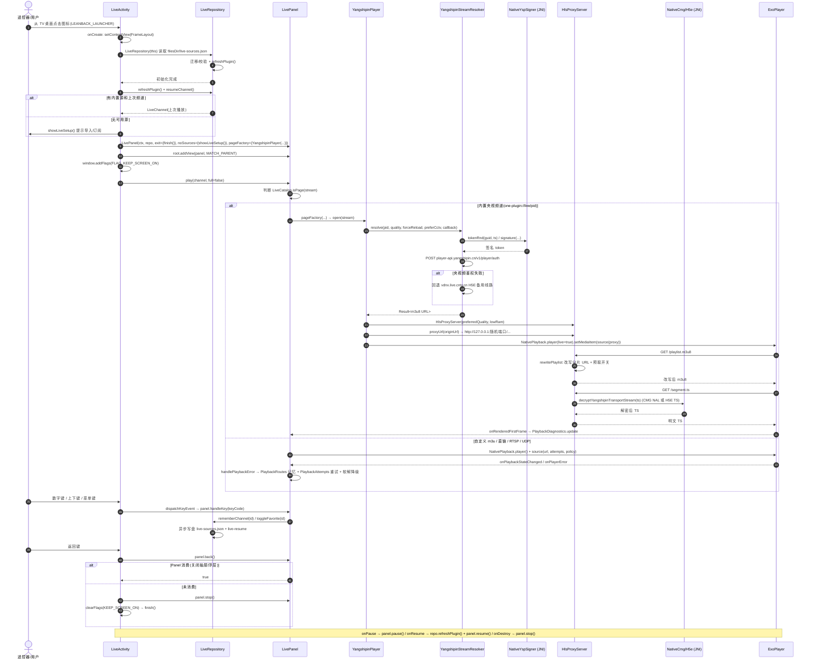
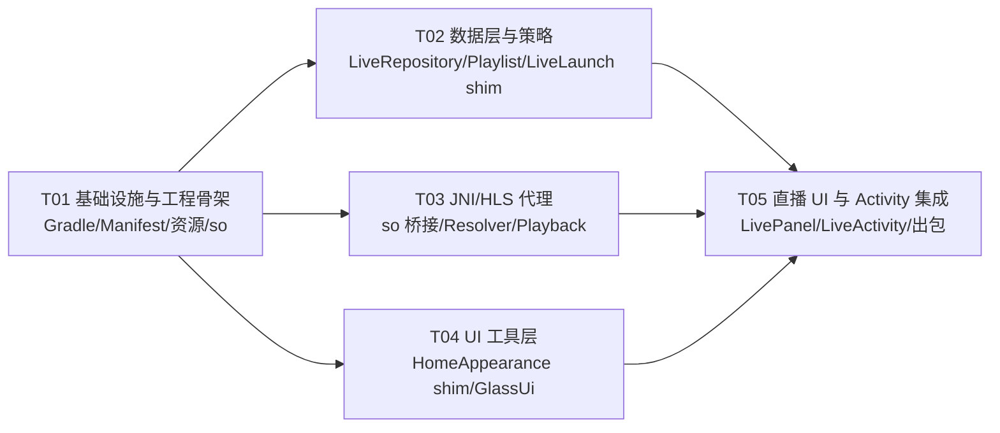

# OneTV 直播剥离 — 独立 Android TV APK 架构设计文档

| 项目 | 内容 |
|---|---|
| 文档版本 | v1.0 |
| 架构师 | 高见远（Gao / software-architect） |
| 源工程 | `/Users/licheng/Downloads/OneTV-main` |
| 目标工程 | 全新独立 Gradle 工程（建议目录名 `onetv-live-apk`） |
| 目标产物 | `app-arm64-v8a-debug.apk`、`app-armeabi-v7a-debug.apk`、`app-universal-debug.apk` |
| 设计原则 | **整体改动最小化、可编译优先、完整复刻直播能力、JNI 符号零破坏** |

---

## 1. 实现方案总述与框架选型

### 1.1 结论摘要

不做重写、不做重构式移植，采用 **"源码切片 + 薄适配层"** 策略：

1. 从 OneTV 主工程中切出 **21 个直播核心源文件 + 3 个 JNI 桥接类 + 8 个 UI 工具类**，共 32 个源码文件，包声明 **保持 `com.tvbridge.app` 不变**。
2. 新建 **3 个适配文件**：`LiveActivity.kt`（承接生命周期）、`LiveLaunch.kt`（内置模式常量 shim）、精简版 `HomeAppearance.kt`（深色主题 shim）。
3. 新建独立 Gradle 工程，`applicationId = com.onetv.live`，`namespace` 保持 `com.tvbridge.app`。
4. 不引入 Hilt、不引入 ViewModel、不引入 Compose。沿用现有 `object` 单例 + `LiveRepository` 持有状态 + `FrameLayout` 自绘 UI 的风格，保证与源逻辑逐行等价。
5. 央视频道（含 CMG/H5E 加密流解密）、自定义 m3u、清晰度、收藏、数字选台、分组、线路记忆、断点续播全部保留。

### 1.2 核心技术难点与对策

| 难点 | 对策 |
|---|---|
| 直播不是 Activity，而是 `MainActivity` 的一个 `screen` 状态 | 新建 `LiveActivity`，把 `MainActivity` 中 `showLive/showLiveSetup/liveUpdated/playChannel/dispatchKeyEvent/onResume/onPause/onDestroy` 的直播分支原样搬入；`LivePanel` 的 `exit` 回调由 `{showHome()}` 改为 `{finish()}`，`noSources` 改为 App 内设置弹窗 |
| JNI so 内部符号与 Java 包名强绑定 | **严禁改 `com.bu.cc.tv` 包名与 3 个类的类名/方法签名**；主源码包也不改，只改 `applicationId`（详见 §9.1） |
| `Hub.kt` 全局单例把直播与桌面/遥控/LAN 耦合 | 不复制 `Hub`；`LiveActivity` 直接 `lateinit var repo: LiveRepository` 持有；删除遥控 `liveImport/livePlayer` 等命令处理（新 App 无遥控入口） |
| `LiveRepository` / `LiveCatalog` 引用 `LiveLaunch.builtIn()` 判断"内置 vs 自定义"模式 | 用 `LiveLaunch.kt` shim 固定返回 `true`，使 `sourceList()`、`snapshot()`、`refreshPlugin()` 逻辑**一行不改**地走内置央视频道路径（详见 §9.3） |
| UI 工具类隐式依赖 `HomeAppearance` → 壁纸下载/EXIF/网络 | 方案 B：新建 4 方法精简 shim，工具类保持原样，避免连带搬运 3 个壁纸文件和 `exifinterface` 依赖（详见 §1.4） |
| 老设备（API 19~20）TLS 与央视频私有 API 签名 | 保留 `LegacyTls.kt` + `legacy-ca.pem` + conscrypt；签名依赖 `libyangshipin.so` 内的 CJS 内核，签名算法变更是固有维护成本（详见 §10） |
| 本地 HLS 代理需绑定 `127.0.0.1` 随机端口 | 保留 `HlsProxyServer.kt` 与 3 个 TS/PES 缓冲 Java 类，Manifest 无需额外权限（loopback 不受 INTERNET 权限限制，但保留 INTERNET） |

### 1.3 框架选型与理由

| 层次 | 选型 | 理由 |
|---|---|---|
| 构建 | AGP 8.7.3 / Kotlin 2.0.21 / Gradle 8.9 / JDK 17 / compileSdk 35 / minSdk 19 / targetSdk 35 | 与源工程完全一致，避免 Gradle/Kotlin 版本差异导致的编译问题 |
| 播放 | Media3 ExoPlayer 1.4.1（exoplayer / hls / dash / rtsp / smoothstreaming / ui） | `NativePlayback`、`LivePanel` 直接依赖这些 artifact |
| 软解 | nextlib-media3ext v0.8.2 | `NativeDecoders` 通过 FFmpeg 扩展实现软解降级 |
| 加密流解密 | 现有 `.so`：`libyangshipin.so`、`libh5estream.so` | 不可重建，必须原样搬运；JNI 类保持 `com.bu.cc.tv` |
| TLS | conscrypt-android 2.5.3 + `LegacyTls.kt` | API<21 老盒子必须；`LegacyTls` 是唯一 import conscrypt 的文件 |
| DI / 状态 | `object` 单例 + `LiveRepository(context)` 手动持有 | 零新增依赖、与源逻辑等价、可编译优先；不引入 Hilt/ViewModel |
| UI | 原生 `FrameLayout` + 自绘 `View` + `PlayerView` | 直播 UI 是纯自绘，引入 Compose/Material 反而需要重写 |
| 架构模式 | 轻量 MVC：`LiveActivity`(Controller) → `LivePanel`(View) → `LiveRepository`(Model) + `YangshipinPlayer`(播放 Facade) | 与源工程 `MainActivity` 的分工一致 |

### 1.4 主题依赖链决策：方案 B（推荐）

**问题**：`LivePanel` / `YangshipinPlayer` 依赖 `NativeUi`、`GlassUi`、`AppIcons`、`LoadingSpinner`、`UiSounds`，这些又依赖 `HomeAppearance`。原版 `HomeAppearance`（181 行）进一步依赖 `OnlineWallpapers`（80 行，Bing 壁纸网络请求）、`ProceduralWallpaper`（50 行）、`AppThreads`（29 行），并 import `androidx.exifinterface.media.ExifInterface`（图片 EXIF 方向修正）。直播调用时强制 `dark=true, video=true`，壁纸分支实际不会呈现。

| 方案 | 内容 | 代价 | 风险 |
|---|---|---|---|
| A：连带复制 | 复制 `HomeAppearance` + `OnlineWallpapers` + `ProceduralWallpaper` + `AppThreads`，保留 `exifinterface` 依赖 | 多 4 个文件 / ~340 行 / 多 1 个三方依赖；引入壁纸网络请求与 SharedPreferences 副作用 | 视觉 100% 一致，但构建面变大 |
| **B：精简 shim（推荐）** | 新建同名 `HomeAppearance` object，仅实现工具类实际调用的 4 个方法：`dark()=true`、`key()=固定串`、`backdrop()=纯色 Bitmap`、`drawBackdrop()=纯色填充`；工具类文件一行不改 | 新增 1 个约 30 行的文件 | 极低：直播场景原本就强制 dark+video；需 QA 回归一次毛玻璃观感 |

**选择 B 的依据**（已通过代码核实）：
- 源码中 `NativeUi`/`GlassUi`/`AppIcons`/`LoadingSpinner`/`UiSounds`/`RemoteText` 对 `HomeAppearance` 的调用**仅 4 个方法**：`dark()` ×7、`key()` ×1、`backdrop()` ×1、`drawBackdrop()` ×1。
- `GlassUi.backdrop()` 走 `GlassUi.surface(..., video=true, dark=true, faint=true)`，`dark=true` 由 `LivePanel` 显式传入，shim 的 `dark()` 只影响少数默认参数路径，固定 `true` 与直播场景一致。
- `backdrop()` 返回 **非 null `Bitmap`**（`GlassUi.frost(image)` 不接受 null），shim 必须返回缓存的纯色 Bitmap，不能返回 null。
- 规避 `exifinterface` 依赖，可在 `app/build.gradle` 中彻底删除 exifinterface / zxing。

> 回退方案：若 QA 发现毛玻璃观感差异，改为方案 A（把 4 个原文件复制回来 + 恢复 `exifinterface` 依赖），无需改动任何直播核心文件。

### 1.5 包名 / applicationId 决策（高层结论，详见 §9.1）

- `applicationId`：`com.tvbridge.app` → **`com.onetv.live`**（可与 OneTV 共存安装）。
- `namespace` 与所有 Kotlin/Java `package` 声明：**保持 `com.tvbridge.app`**。
- JNI 桥接包：**保持 `com.bu.cc.tv`**。
- Manifest 中所有组件用**全限定类名**，消除 namespace/applicationId 差异带来的相对名解析歧义。

---

## 2. 完整文件清单

> 源路径基准：`/Users/licheng/Downloads/OneTV-main/app/`
> 目标路径基准：新工程 `onetv-live-apk/app/`
> 动作图例：**复制**=原样搬运（包声明不改）；**复制+改**=搬运后按要点微调；**新建**=全新编写；**裁剪**=从源文件抽取子集；**不搬运**=留在源工程。

### 2.1 直播核心源码（21 个，`src/main/java/com/tvbridge/app/`）

| # | 源路径 | 目标路径 | 动作 | 改动要点 |
|---|---|---|---|---|
| 1 | `src/main/java/com/tvbridge/app/LivePanel.kt` (533行) | 同名 | 复制+改 | ① `exit` 由 `{showHome()}` 改为 `{finish()}`（在 LiveActivity 注入，本文件不改）② 保留 `import com.tvbridge.app.BuildConfig`（需 `buildConfig true`）③ 删除 `dispatchKeyEvent` 中不存在的应用级按键分支——实际本文件无外部跳转，可原样复制 ④ 保留全部分组/收藏/数字选台/清晰度逻辑 |
| 2 | `src/main/java/com/tvbridge/app/LiveRepository.kt` (214行) | 同名 | 复制 | 依赖 `LiveLaunch`/`LiveCatalog`/`PlaylistParser`/`LegacyTls`，均由 shim 与复制文件满足；`filesDir/live-sources.json`、`live-resume`、`live-subscriptions` 持久化原样保留 |
| 3 | `src/main/java/com/tvbridge/app/LiveCatalog.kt` | 同名 | 复制 | `SOURCE="one-plugin://live"`；`available()` 依赖 `LiveLaunch.builtIn()` shim 固定 true |
| 4 | `src/main/java/com/tvbridge/app/PlaylistParser.kt` | 同名 | 复制 | 含 `data class LiveChannel`；`httpUrl()` 仅被 `LiveRepository.subscribe()` 使用，浏览器不搬运不影响 |
| 5 | `src/main/java/com/tvbridge/app/YangshipinCatalog.kt` | 同名 | 复制 | 读取 `assets/yangshipin-channels.json`；唯一 "BootReceiver" 出现处是注释，无需处理 |
| 6 | `src/main/java/com/tvbridge/app/YangshipinApiPayload.kt` (256行) | 同名 | 复制 | MD5/AES-CBC/cKey/ticket 签名载荷；依赖 JNI `NativeYspSigner` |
| 7 | `src/main/java/com/tvbridge/app/YangshipinPlayer.kt` (328行) | 同名 | 复制 | 默认源播放器；流解析→本地 HLS 代理→ExoPlayer；含重连/软解降级/清晰度；依赖 `PlayerView` |
| 8 | `src/main/java/com/tvbridge/app/YangshipinPlaybackCoordinator.kt` | 同名 | 复制 | `typealias`，仅依赖 `YangshipinPlayer` |
| 9 | `src/main/java/com/tvbridge/app/YangshipinStreamResolver.kt` (274行) | 同名 | 复制 | player-api 鉴权 + CCTV vdnx 备用线路；依赖 `NativeYspSigner`/`HlsProxyServer` |
| 10 | `src/main/java/com/tvbridge/app/NativePlayback.kt` | 同名 | 复制 | `player()/source()/browserSource()`；依赖 `PlaybackAttempts`、`NativeDecoders`、`OfficialDecoders` |
| 11 | `src/main/java/com/tvbridge/app/NativeDecoders.kt` | 同名 | 复制 | nextlib FFmpeg 软解检测 |
| 12 | `src/main/java/com/tvbridge/app/OfficialDecoders.kt` | 同名 | 复制 | 硬解器淘汰策略 |
| 13 | `src/main/java/com/tvbridge/app/PlaybackRoutes.kt` | 同名 | 复制 | 线路记忆；依赖 `LiveCatalog`、`PlaylistParser` |
| 14 | `src/main/java/com/tvbridge/app/PlaybackAttempts.kt` | 同名 | 复制 | 重试策略 |
| 15 | `src/main/java/com/tvbridge/app/PlaybackDiagnostics.kt` | 同名 | 复制 | 诊断指标；`Hub` 中的 `playbackData` 上报入口删除即可，本文件不改 |
| 16 | `src/main/java/com/tvbridge/app/PagePlayback.kt` | 同名 | 复制 | 播放器接口 |
| 17 | `src/main/java/com/tvbridge/app/HlsProxyServer.kt` (844行) | 同名 | 复制 | 本地 `127.0.0.1` 代理、m3u8 改写、分片预取、CMG/H5E 实时解密；依赖 3 个 JNI 类与 3 个缓冲类 |
| 18 | `src/main/java/com/tvbridge/app/LegacyTls.kt` (72行) | 同名 | 复制 | API<21 TLS；读取 `assets/legacy-ca.pem`；唯一 conscrypt 使用点 |
| 19 | `src/main/java/com/tvbridge/app/CmgTsStream.java` | 同名 | 复制 | TS 流解密辅助 |
| 20 | `src/main/java/com/tvbridge/app/CmgBytePipe.java` | 同名 | 复制 | 字节管道 |
| 21 | `src/main/java/com/tvbridge/app/ProgressiveMediaBuffer.java` | 同名 | 复制 | 渐进式分片缓冲 |

### 2.2 JNI 桥接层（3 个，**包名不可改**，`src/main/java/com/bu/cc/tv/`）

| # | 源路径 | 目标路径 | 动作 | 改动要点 |
|---|---|---|---|---|
| 22 | `src/main/java/com/bu/cc/tv/NativeCmgDecryptor.java` | 同路径 | **原样复制** | `package com.bu.cc.tv;` 与全部 `native` 方法签名一字不改；`System.loadLibrary("yangshipin")` 保持 |
| 23 | `src/main/java/com/bu/cc/tv/NativeYspSigner.java` | 同路径 | **原样复制** | `tokenRnd/signature`；`System.loadLibrary("yangshipin")` |
| 24 | `src/main/java/com/bu/cc/tv/NativeH5eDecryptor.java` | 同路径 | **原样复制** | `decryptTransportStream*` 等；`System.loadLibrary("h5estream")` |

### 2.3 UI 工具类（7 个，`src/main/java/com/tvbridge/app/`）

| # | 源路径 | 目标路径 | 动作 | 改动要点 |
|---|---|---|---|---|
| 25 | `src/main/java/com/tvbridge/app/NativeUi.kt` (314行) | 同名 | 复制 | 不改；依赖 shim `HomeAppearance.dark()` |
| 26 | `src/main/java/com/tvbridge/app/GlassUi.kt` (428行) | 同名 | 复制+改 | **删除第 136 行** `if (activity(context)?.javaClass?.name == "com.tvbridge.app.BrowserActivity") return false`；`com.tvbridge.engine` 判断可保留（新包中恒 false，无害） |
| 27 | `src/main/java/com/tvbridge/app/AppIcons.kt` (90行) | 同名 | 复制 | 纯 Path 绘制，无资源引用 |
| 28 | `src/main/java/com/tvbridge/app/LoadingSpinner.kt` (32行) | 同名 | 复制 | 不改 |
| 29 | `src/main/java/com/tvbridge/app/UiSounds.kt` (56行) | 同名 | 复制 | 合成音，无 raw 资源引用 |
| 30 | `src/main/java/com/tvbridge/app/RemoteText.kt` (50行) | 同名 | 复制 | `NativeUi` 间接依赖，无外部类依赖 |
| 31 | `src/main/java/com/tvbridge/app/AppThreads.kt` (29行) | 同名 | 复制 | 线程池工具，`LivePanel`/`LiveRepository` 间接需要 |

### 2.4 裁剪 / 新建源码（3 个）

| # | 源路径 | 目标路径 | 动作 | 改动要点 |
|---|---|---|---|---|
| 32 | `src/main/java/com/tvbridge/app/LiveSettings.kt` | `src/main/java/com/tvbridge/app/LiveLaunch.kt` | **裁剪+新建** | **只保留** `object LiveLaunch`：`builtIn(ctx)=true`、`label(ctx)="内置直播"`、`selectInternal(ctx,mode,repo)=true`（兼容占位）。**删除** `class LiveSettings` 对话框与所有 `Hub.live` 引用，不复制 `SharedPreferences("startup")` 的 `live_mode` 读写（新 App 无"默认/自定义"切换） |
| 33 | `src/main/java/com/tvbridge/app/HomeAppearance.kt` | `src/main/java/com/tvbridge/app/HomeAppearance.kt` | **新建精简版** | 同名 object，仅 4 个方法：`dark(ctx)=true`；`key(ctx)="com.onetv.live:live:dark"`（固定串，保证 GlassUi frost 缓存 key 稳定）；`backdrop(ctx,w,h,dark):Bitmap` 返回缓存纯色 `0xFF121820` Bitmap；`drawBackdrop(ctx,canvas,w,h,dark,paint)` 用 paint 填纯色。**不要复制**原文件其余方法、不要 import exifinterface |
| 34 | —（源工程无） | `src/main/java/com/tvbridge/app/LiveActivity.kt` | **新建** | 详见 §3；实现生命周期、按键分发、设置弹窗（导入/订阅/源管理/收藏）、`exit` 与 `noSources` 回调 |

### 2.5 工程配置 / 资源 / 原生库 / assets

| # | 源路径 | 目标路径 | 动作 | 改动要点 |
|---|---|---|---|---|
| 35 | `build.gradle`（root） | 同名 | 复制 | AGP 8.7.3 / Kotlin 2.0.21 插件声明不变 |
| 36 | `settings.gradle` | 同名 | 复制+改 | `rootProject.name='ONETV-Live'`；JitPack `includeGroup 'com.github.anilbeesetti.nextlib'` 与 mozilla maven 保留（nextlib 需要） |
| 37 | `gradle.properties` | 同名 | 复制 | `org.gradle.jvmargs=-Xmx2048m`、`android.useAndroidX=true` |
| 38 | `gradle/wrapper/*`、`gradlew`、`gradlew.bat` | 同名 | 复制 | Gradle 8.9 wrapper |
| 39 | `app/build.gradle` | 同名 | **新建** | 详见 §4 |
| 40 | `app/proguard-rules.pro` | 同名 | 复制 | debug 不生效；保留供 release |
| 41 | `app/src/main/AndroidManifest.xml` | 同名 | **新建** | 详见 §3.3；权限大幅精简 |
| 42 | `src/main/res/values/theme.xml` | 同名 | 复制 | `AppTheme`/`LiveThemeBase`/`LiveTheme`；Feed `LiveActivity` 使用 `@style/LiveTheme` |
| 43 | `src/main/res/values-v21/theme.xml` | 同名 | 复制 | Material 主题变体 |
| 44 | `src/main/res/values-v31/live_theme.xml` | 同名 | 复制 | Splash/系统栏深色 |
| 45 | `src/main/res/drawable-v21/one_foreground.xml` | 同名 | 复制 | 自适应图标前景 |
| 46 | `src/main/res/drawable-v26/one_adaptive.xml` | 同名 | 复制 | 自适应图标 |
| 47 | `src/main/res/drawable-v33/one_adaptive.xml`、`one_monochrome.xml` | 同名 | 复制 | 单色图标 |
| 48 | `src/main/res/drawable-v21/one_icon.xml`、`notification_icon.xml` | 同名 | 复制 | 备用图标（Notification 权限已删除，可保留无害） |
| 49 | `src/main/res/drawable-xxhdpi/launcher_display.png`、`drawable-xxxhdpi/launcher_display.png` | 同名 | 复制 | Android TV 桌面 banner（`android:banner`）必需 |
| 50 | `src/main/assets/yangshipin-channels.json` | 同名 | 复制 | **必需**：内置央视频道表 |
| 51 | `src/main/assets/legacy-ca.pem` | 同名 | 复制 | **建议保留**：API<21 TLS 根证书 |
| 52 | `src/main/jniLibs/arm64-v8a/libyangshipin.so`、`libh5estream.so` | 同路径 | 复制 | **必需**，二进制原样 |
| 53 | `src/main/jniLibs/armeabi-v7a/libyangshipin.so`、`libh5estream.so` | 同路径 | 复制 | **必需**，二进制原样 |
| 54 | `src/main/assets/licenses/*`（cctv-h5e / conscrypt / nextlib / legacy-ca 等） | 同名 | 复制 | 合规要求：保留第三方许可证文本 |
| 55 | `app/libs/zxing-core-3.5.3.jar` | — | **不搬运** | 仅 `TvHomeView` 用，直播链路无引用 |

### 2.6 明确不搬运的文件（其余约 40 个源文件）

`MainActivity.kt`、`Hub.kt`、`BrowserActivity.kt`、`TvHomeView.kt`、`LanServer.kt`、`RemoteHostService.kt`、`RemoteInputService.kt`、`BootReceiver.kt`、`Desktop*.kt`（Takeover/GuardService/Recovery/State/Sync/Policy/Foreground）、`SystemControls.kt`、`*InputAdapter.kt`（Hisense/Konka/Xgimi）、`ApkInstaller.kt`、`GithubUpdates.kt`、`UpdateController.kt`、`AppearanceController.kt`、`WallpaperDraft.kt`、`OnlineWallpapers.kt`、`ProceduralWallpaper.kt`、`HomeFolderArtwork.kt`、`AppArtwork.kt`、`AppModules.kt`、`AppTileView.kt`、`LauncherApps.kt`、`DeviceAdapters.kt`、`DeviceProfile.kt`、`FileExporter.kt`、`GlobalPointer.kt`、`ConnectionState.kt`、`ChanghongSettings.kt`、`AdbRemote.kt`、`InstallHandoff.kt`、`InputRoutes.kt`、`BrowserBookmarks.kt`、`LiveSettings.kt`（仅抽 LiveLaunch）、原 `HomeAppearance.kt`（由 shim 替代）。

对应**不搬运的资源**：`res/xml/desktop_*.xml`、`res/xml/remote_input_method.xml`、`res/values/desktop_*.xml`、`assets/device-adapters.json`、`assets/remote.html`、`res/drawable-nodpi/home_*.webp`。

---

## 3. LiveActivity 与 AndroidManifest 设计

### 3.1 LiveActivity 详细设计

```kotlin
package com.tvbridge.app

class LiveActivity : Activity() {
    // 1) 单例式持有：不引入 Hub，不用 Hilt
    lateinit var repo: LiveRepository          // onCreate 中 LiveRepository(this)
    private var livePanel: LivePanel? = null

    override fun onCreate(savedInstanceState: Bundle?) {
        super.onCreate(savedInstanceState)
        repo = LiveRepository(this)            // 从 filesDir 恢复源/收藏/断点
        val root = FrameLayout(this)
        setContentView(root)
        showLive()                             // 等价 MainActivity.showLive(autoPlay=true)
        // 支持外部以 "open_live" / channel id 拉起（可选）
    }
}
```

**必须迁移的 `MainActivity` 直播分支（逐条对应）：**

| 源 `MainActivity` 行为 | `LiveActivity` 落点 |
|---|---|
| `showLive(autoPlay)`：refreshPlugin → resumeChannel → 无源则 showLiveSetup → `LivePanel(this, Hub.live, {showHome()}, noSources={...}, pageFactory={...})` → `addView` → `FLAG_KEEP_SCREEN_ON` | `showLive()`：`exit={finish()}`、`noSources={showLiveSetup()}`、`pageFactory={c,tap,state -> YangshipinPlayer(c,tap,state)}`；`root.addView(panel, FrameLayout.LayoutParams(-1,-1))`；`window.addFlags(FLAG_KEEP_SCREEN_ON)` |
| `showLiveSetup()`（无内置源时提示/设置） | 用 `AlertDialog` 实现：提供"导入节目单 / 添加直播源 / 订阅 URL"入口，成功后回调 `liveUpdated()` |
| `liveUpdated()`：`if(resumeChannel()!=null) showLive() else livePanel?.refresh()` | 同名方法，逻辑照搬，去掉 `screen` 判断 |
| `playChannel(id)` | 可选：解析 `intent.getStringExtra("channel_id")`，`repo.findChannel(id)` 后 `livePanel?.play(channel, true)` |
| `dispatchKeyEvent`：`if(screen=="live" && livePanel?.handleKey(keyCode)==true) return true` | `override fun dispatchKeyEvent(event: KeyEvent): Boolean = livePanel?.handleKey(event.keyCode)==true || super.dispatchKeyEvent(event)`（注意只在 ACTION_DOWN 转发，与源一致：`event.action==ACTION_DOWN`） |
| `command(cmd,value)` 遥控命令透传 | 可选保留 `livePanel?.command(cmd,value)` 供 Intent extra 使用；无遥控服务则可不接 |
| `onBackPressed()`：`"live" -> if(livePanel?.back()!=true) showHome()` | `if(livePanel?.back()!=true) finish()`；API 33+ 用 `OnBackPressedDispatcher` 或保留 `onBackPressed()`（targetSdk 35 需兼容 `onBackPressed` 弃用但仍可用） |
| `onResume()`：`Hub.live.refreshPlugin(); livePanel?.resume()` | `repo.refreshPlugin(); livePanel?.resume()` |
| `onPause()`：`livePanel?.pause()` | 同 |
| `onDestroy()`：`livePanel?.stop(); root.removeView` | 同 + `repo` 无需显式 destroy（其线程池随进程） |

**配置要点：**
- `android:exported="true"`（LAUNCHER/LEANBACK_LAUNCHER intent-filter 要求）
- `android:screenOrientation="landscape"`（与源 MainActivity 一致，TV 横屏）
- `android:launchMode="singleTask"`（与源一致）
- `android:theme="@style/LiveTheme"`
- `android:banner="@drawable/launcher_display"`、`android:icon="@drawable/one_adaptive"`
- `android:name` 用全限定 `com.tvbridge.app.LiveActivity`
- `intent-filter`：`MAIN + LAUNCHER` 与 `MAIN + LEANBACK_LAUNCHER` 两个（手机/模拟器调试 + TV 桌面入口）
- `window.addFlags(FLAG_KEEP_SCREEN_ON)` 播放期间常亮，`onPause` 时 `clearFlags`（源 `showHome` 有 clearFlags，新 App 在 `onPause/onDestroy` 补上）

### 3.2 最小 AndroidManifest 设计（新建）

```xml
<manifest xmlns:android="http://schemas.android.com/apk/res/android"
          xmlns:tools="http://schemas.android.com/tools">

    <!-- nextlib-media3ext 声明的 minSdk 高于 19，必须保留 override -->
    <uses-sdk tools:overrideLibrary="io.github.anilbeesetti.nextlib.media3ext" />

    <!-- 直播必需 -->
    <uses-permission android:name="android.permission.INTERNET" />
    <uses-permission android:name="android.permission.ACCESS_NETWORK_STATE" />
    <uses-permission android:name="android.permission.ACCESS_WIFI_STATE" />
    <uses-permission android:name="android.permission.CHANGE_WIFI_MULTICAST_STATE" />
    <uses-permission android:name="android.permission.CHANGE_NETWORK_STATE" />
    <uses-permission android:name="android.permission.MODIFY_AUDIO_SETTINGS" />
    <uses-permission android:name="android.permission.WAKE_LOCK" />

    <!-- TV 特征声明 -->
    <uses-feature android:name="android.software.leanback" android:required="false" />
    <uses-feature android:name="android.hardware.touchscreen" android:required="false" />
    <uses-feature android:name="android.hardware.wifi" android:required="false" />

    <application
        android:name="androidx.multidex.MultiDexApplication"
        android:label="OneTV 直播"
        android:theme="@style/LiveTheme"
        android:banner="@drawable/launcher_display"
        android:icon="@drawable/one_adaptive"
        android:roundIcon="@drawable/one_adaptive"
        android:allowBackup="false"
        android:usesCleartextTraffic="true"
        android:supportsRtl="true">

        <activity
            android:name="com.tvbridge.app.LiveActivity"
            android:exported="true"
            android:screenOrientation="landscape"
            android:launchMode="singleTask"
            android:theme="@style/LiveTheme"
            android:banner="@drawable/launcher_display"
            android:icon="@drawable/one_adaptive">
            <intent-filter>
                <action android:name="android.intent.action.MAIN" />
                <category android:name="android.intent.category.LAUNCHER" />
            </intent-filter>
            <intent-filter>
                <action android:name="android.intent.action.MAIN" />
                <category android:name="android.intent.category.LEANBACK_LAUNCHER" />
            </intent-filter>
        </activity>
    </application>
</manifest>
```

**权限裁剪对照：**

| 保留 | 删除（与直播无关） |
|---|---|
| INTERNET、ACCESS_NETWORK_STATE、ACCESS_WIFI_STATE、CHANGE_WIFI_MULTICAST_STATE（组播）、CHANGE_NETWORK_STATE、MODIFY_AUDIO_SETTINGS、WAKE_LOCK | READ/WRITE_SYNC_SETTINGS、GET_ACCOUNTS、AUTHENTICATE_ACCOUNTS、MANAGE_ACCOUNTS、WRITE_SECURE_SETTINGS、PACKAGE_USAGE_STATS、SYSTEM_ALERT_WINDOW、RECEIVE_BOOT_COMPLETED、POST_NOTIFICATIONS、REQUEST_INSTALL_PACKAGES、UPDATE_PACKAGES_WITHOUT_USER_ACTION、QUERY_ALL_PACKAGES、REQUEST_DELETE_PACKAGES、WRITE_EXTERNAL_STORAGE、FOREGROUND_SERVICE(_CONNECTED_DEVICE)、整个 `<queries>` 段、BootReceiver / 各类 Service / activity-alias / FileProvider |

> 说明：`usesCleartextTraffic="true"` 保留——老 m3u 源常为 http，且本地 HLS 代理走 `http://127.0.0.1`。

---

## 4. app/build.gradle 设计（新建）

```groovy
plugins {
    id 'com.android.application'
    id 'org.jetbrains.kotlin.android'
}

def playerVersion = '1.4.1'

android {
    buildFeatures { buildConfig true }          // LivePanel 使用 BuildConfig.DEBUG，必须开
    namespace 'com.tvbridge.app'                // 保持！与源码 package 一致（见 §9.1）
    compileSdk 35
    buildToolsVersion '35.0.0'

    defaultConfig {
        applicationId 'com.onetv.live'          // 新身份，可与 OneTV 共存
        minSdk 19
        targetSdk 35
        versionCode 1
        versionName '1.0'
        resConfigs "zh", "en"
        multiDexEnabled true
    }

    splits {
        abi {
            enable true
            reset()
            include 'armeabi-v7a', 'arm64-v8a'
            universalApk true
        }
    }

    compileOptions {
        sourceCompatibility JavaVersion.VERSION_17
        targetCompatibility JavaVersion.VERSION_17
    }
    kotlinOptions { jvmTarget = '17' }

    buildTypes {
        release {
            minifyEnabled false                 // 首版建议关闭，避免 so/JNI 反射被裁剪
            shrinkResources false
            proguardFiles getDefaultProguardFile('proguard-android-optimize.txt'), 'proguard-rules.pro'
        }
    }

    // 与源工程一致：排除 conscrypt 的 arm64 JNI（避免与系统冲突）及 x86 库
    packagingOptions {
        jniLibs {
            excludes += ['**/arm64-v8a/libconscrypt_jni.so', '**/x86/**', '**/x86_64/**']
        }
    }

    testOptions {
        unitTests.includeAndroidResources = true
        unitTests.all {
            systemProperty 'robolectric.conscryptMode', 'OFF'
            systemProperty 'robolectric.dependency.repo.url', 'https://repo.maven.apache.org/maven2'
        }
    }
}

dependencies {
    implementation 'org.conscrypt:conscrypt-android:2.5.3'       // LegacyTls
    implementation 'androidx.multidex:multidex:2.0.1'            // minSdk19 + multiDex
    implementation 'androidx.core:core:1.9.0'

    implementation "androidx.media3:media3-exoplayer:${playerVersion}"
    implementation "androidx.media3:media3-exoplayer-hls:${playerVersion}"
    implementation "androidx.media3:media3-exoplayer-dash:${playerVersion}"
    implementation "androidx.media3:media3-exoplayer-rtsp:${playerVersion}"
    implementation "androidx.media3:media3-exoplayer-smoothstreaming:${playerVersion}"
    implementation "androidx.media3:media3-ui:${playerVersion}"  // PlayerView
    implementation 'com.github.anilbeesetti.nextlib:nextlib-media3ext:v0.8.2'

    testImplementation 'junit:junit:4.13.2'
    testImplementation 'org.json:json:20240303'
    testImplementation 'org.robolectric:robolectric:4.14.1'
}
```

**依赖变更说明：**

| 保留 | 删除 | 原因 |
|---|---|---|
| conscrypt、multidex、core、media3 ×6、nextlib | `androidx.exifinterface:exifinterface:1.3.6`（方案 B shim 后无人使用）、`files('libs/zxing-core-3.5.3.jar')`（仅 TvHomeView 使用） | 见 §1.4 / §2.6 |
| `buildConfig true`、`splits`、`packagingOptions`、`uses-sdk overrideLibrary` | release 签名配置 `ONE_KEYSTORE_*`（首版 debug 出包不需要） | 降低首版配置复杂度 |

---

## 5. 关键数据结构与接口

### 5.1 类图（Mermaid classDiagram）

```mermaid
classDiagram
    class LiveActivity {
        - LiveRepository repo
        - LivePanel livePanel
        + onCreate(Bundle) void
        + showLive() void
        + showLiveSetup() void
        + liveUpdated() void
        + playChannel(String) boolean
        + dispatchKeyEvent(KeyEvent) boolean
        + onBackPressed() void
        + onResume() void
        + onPause() void
        + onDestroy() void
    }

    class LivePanel {
        - LiveRepository repo
        - PagePlayback officialPlayer
        - ExoPlayer nativePlayer
        - PlaybackRoutes routes
        - PlaybackAttempts attempts
        + LivePanel(Context, LiveRepository, Function0, Function0, Function3)
        + play(LiveChannel, boolean) void
        + refresh(boolean) void
        + handleKey(int) boolean
        + back() boolean
        + command(String, String) boolean
        + pause() void
        + resume() void
        + stop() void
    }

    class LiveRepository {
        - File file
        - MutableList~Source~ sources
        - MutableSet~String~ favorites
        - String active
        + DEFAULT_SOURCE String
        + allChannels() List~LiveChannel~
        + sourceList() List~Source~
        + findChannel(String) LiveChannel
        + favoriteChannels() List~LiveChannel~
        + resumeChannel() LiveChannel
        + rememberChannel(String) void
        + toggleFavorite(String) void
        + selectSource(String) void
        + subscribe(String) boolean
        + importText(String) boolean
        + addDirect(String, String) boolean
        + snapshot(String) String
        + refreshPlugin() void
    }

    class Source {
        + String url
        + String name
        + List~LiveChannel~ channels
        + long updated
    }

    class LiveChannel {
        + String id
        + String name
        + String group
        + List~String~ streams
        + json() JSONObject
    }

    class PlaylistParser {
        + MAX_BYTES int
        + MAX_CHANNELS int
        + parse(String, String, String) List~LiveChannel~
        + streamUrl(String) String
        + httpUrl(String) String
        + playlistAddress(String) String
        + digest(String) String
    }

    class LiveLaunch {
        + builtIn(Context) boolean
        + label(Context) String
        + selectInternal(Context, String, LiveRepository) boolean
    }

    class LiveCatalog {
        + SOURCE String
        + isPage(String) boolean
        + available(Context) boolean
        + read(Context) Result
    }

    class YangshipinCatalog {
        + channels(AssetManager) List~LiveChannel~
    }

    class PagePlayback {
        <<interface>>
        + View view
        + String quality
        + open(String, boolean) void
        + setQuality(String) void
        + toggle() void
        + pauseVideo() void
        + suspend() void
        + resume() void
        + stop() void
        + release() void
    }

    class YangshipinPlayer {
        - YangshipinStreamResolver resolver
        - HlsProxyServer proxy
        + open(String, boolean) void
        + setQuality(String) void
        + release() void
    }

    class YangshipinStreamResolver {
        - Context context
        + resolve(String, String, boolean, boolean, Function1) void
        + cancel() void
        + release() void
    }

    class NativePlayback {
        + player(Context, int, int, boolean, boolean) ExoPlayer
        + source(Context, String, PlaybackAttempts, LoadErrorHandlingPolicy) MediaSource
        + softwareAvailable() boolean
    }

    class HlsProxyServer {
        - ServerSocket server
        + proxyUrl(String) String
        + setPrefetchEnabled(boolean) void
        + close() void
    }

    class NativeCmgDecryptor {
        <<JNI com.bu.cc.tv — 包名不可改>>
        + decodeNalRangeInPlace(byte[], int, int, boolean, boolean) int
        + probeRuntime() String
    }

    class NativeH5eDecryptor {
        <<JNI com.bu.cc.tv — 包名不可改>>
        + decryptTransportStream(byte[]) byte[]
        + supportsStreamingTransportStream() boolean
    }

    class NativeYspSigner {
        <<JNI com.bu.cc.tv — 包名不可改>>
        + tokenRnd(String, String) String
        + signature(String, String, String) String
    }

    class HomeAppearance {
        <<精简 shim>>
        + dark(Context) boolean
        + key(Context) String
        + backdrop(Context, int, int, boolean) Bitmap
        + drawBackdrop(Context, Canvas, int, int, boolean, Paint) void
    }

    LiveActivity --> LiveRepository : 持有(替代 Hub)
    LiveActivity --> LivePanel : 创建/生命周期
    LivePanel --> LiveRepository : 频道/收藏/源
    LivePanel --> PagePlayback : 默认源播放
    LivePanel --> NativePlayback : 自定义源播放
    LivePanel ..> HomeAppearance : 经 GlassUi/NativeUi
    LiveRepository *-- Source
    Source *-- LiveChannel
    LiveRepository ..> PlaylistParser
    LiveRepository ..> LiveLaunch
    LiveRepository ..> LiveCatalog
    LiveCatalog ..> YangshipinCatalog
    LiveCatalog ..> LiveLaunch
    YangshipinPlayer ..|> PagePlayback
    YangshipinPlayer --> YangshipinStreamResolver
    YangshipinPlayer --> HlsProxyServer
    YangshipinPlayer --> NativePlayback
    YangshipinStreamResolver ..> NativeYspSigner
    YangshipinStreamResolver ..> YangshipinApiPayload
    HlsProxyServer ..> NativeCmgDecryptor
    HlsProxyServer ..> NativeH5eDecryptor
```



### 5.2 LiveRepository 关键 API 契约

| 方法 | 语义 |
|---|---|
| `allChannels(): List<LiveChannel>` | 当前激活源的频道列表；自动修正非法 active |
| `sourceList(): List<Source>` | 内置模式下返回 `url == DEFAULT_SOURCE` 的源；shim 固定 `builtIn=true` |
| `resumeChannel(): LiveChannel?` | 断点续播：读 `live-resume` SharedPreferences，找不到则回退首频道 |
| `rememberChannel(id)` | 记录最后播放频道/时间戳并异步落盘 |
| `snapshot(knownVersion): String` | 供 UI 刷新的 JSON 快照；`playerMode` 固定 `"one"`，`playerName` 固定 `"内置直播"` |
| `subscribe(address)` / `importText(text)` / `addDirect(name,url)` / `removeSource(url)` | 订阅/导入/直链/删除；HTTP 重定向最多 5 次、单源 ≤20 MB、总频道 ≤20000 |
| `toggleFavorite(id)` / `favorite(id)` / `favoriteChannels()` | 收藏集合持久化在 `live-sources.json` |
| `refreshPlugin()` | 每次 onResume 从 `assets/yangshipin-channels.json` 刷新内置央视频道 |

### 5.3 PagePlayback 接口

```kotlin
interface PagePlayback {
    val view: View
    val quality: String
    fun open(address: String, forceReload: Boolean = false)
    fun setQuality(value: String)
    fun toggle(); fun pauseVideo(); fun suspend(); fun resume()
    fun stop(); fun release()
}
```

`YangshipinPlayer` 是默认源实现；自定义 m3u/直链走 `LivePanel` 内的 `NativePlayback.player()/source()` 直接播放（保持源逻辑不变）。

---

## 6. 程序调用流程（Mermaid sequenceDiagram）



---

## 7. 有序任务列表（工程师执行清单）

> 严格 5 个任务，按依赖顺序；T01 为基础设施，T02/T03/T04 可并行，T05 收口集成。

### T01 — 项目基础设施与工程骨架 【P0，依赖：无】

**产出文件**
- `settings.gradle`、`build.gradle`（root）、`gradle.properties`、`gradle/wrapper/*`、`gradlew`、`gradlew.bat`
- `app/build.gradle`（按 §4）、`app/proguard-rules.pro`
- `app/src/main/AndroidManifest.xml`（按 §3.2）
- `res/values/theme.xml`、`res/values-v21/theme.xml`、`res/values-v31/live_theme.xml`
- `res/drawable-v21/{one_foreground.xml,one_icon.xml,notification_icon.xml}`、`res/drawable-v26/one_adaptive.xml`、`res/drawable-v33/{one_adaptive.xml,one_monochrome.xml}`、`res/drawable-{xxhdpi,xxxhdpi}/launcher_display.png`
- `assets/{yangshipin-channels.json,legacy-ca.pem}`、`assets/licenses/*`
- `jniLibs/{arm64-v8a,armeabi-v7a}/{libyangshipin.so,libh5estream.so}`
- 临时 `src/main/java/com/tvbridge/app/LiveActivity.kt` 空壳（仅 `extends Activity`）

**验收点**
1. Gradle sync 成功，JDK17/AGP8.7.3/Kotlin2.0.21 无版本冲突。
2. `./gradlew assembleDebug` 成功，产出 3 个 APK（universal + 2 ABI）。
3. `aapt dump badging` 显示 `package: name='com.onetv.live'`，含 LEANBACK_LAUNCHER，权限清单与 §3.2 一致。
4. 解包 APK 确认 `lib/{arm64-v8a,armeabi-v7a}/libyangshipin.so` 与 `libh5estream.so` 存在。

### T02 — 数据层与播放策略（无 UI）【P0，依赖：T01】

**产出文件**
- `PlaylistParser.kt`（含 `LiveChannel`）、`LiveCatalog.kt`、`YangshipinCatalog.kt`、`YangshipinApiPayload.kt`
- `LiveRepository.kt`、`LiveLaunch.kt`（裁剪 shim）
- `LegacyTls.kt`、`PagePlayback.kt`
- `PlaybackRoutes.kt`、`PlaybackAttempts.kt`、`PlaybackDiagnostics.kt`
- 测试：`PlaylistParserTest.kt`、`YangshipinCatalogTest.kt`、`PlaybackRoutesTest.kt`、`PlaybackAttemptsTest.kt`、`LegacyTlsTest.kt`、`LiveResumeTest.kt`

**验收点**
1. `./gradlew testDebugUnitTest --tests 'com.tvbridge.app.PlaylistParserTest' ...` 全绿。
2. 静态检查：`LiveLaunch.builtIn(ctx)` 恒 true；`LiveRepository.sourceList()` 返回默认源；无 `Hub` 引用。
3. 运行时：断点续播写入 `filesDir/live-sources.json` 与 `live-resume`，重启可恢复。

### T03 — JNI 解密、流解析与 HLS 代理【P0，依赖：T01（逻辑上引用 T02 的 PlaybackAttempts/LiveCatalog）】

**产出文件**
- `com/bu/cc/tv/{NativeCmgDecryptor.java, NativeYspSigner.java, NativeH5eDecryptor.java}`（原样）
- `HlsProxyServer.kt`、`CmgTsStream.java`、`CmgBytePipe.java`、`ProgressiveMediaBuffer.java`
- `YangshipinStreamResolver.kt`、`YangshipinApiPayload.kt`（若 T02 已放则复用）
- `NativeDecoders.kt`、`OfficialDecoders.kt`、`NativePlayback.kt`
- 测试：`HlsTransferTest.kt`、`ResolverRaceTest.kt`、`ProgressiveStreamTest.java`、`NativePlaybackTest.kt`

**验收点**
1. `com.bu.cc.tv` 三个类与 `.so` 符号匹配：真机/模拟器(arm) 调用 `NativeCmgDecryptor.probeRuntime()` 不抛 `UnsatisfiedLinkError`。
2. `HlsProxyServer.proxyUrl()` 返回 `http://127.0.0.1:<随机端口>/...`，m3u8 改写与分片解密单测通过。
3. `NativePlayback.softwareAvailable()` 在含 nextlib 的构建中返回 true。

### T04 — UI 工具层与主题 shim【P0，依赖：T01】

**产出文件**
- `HomeAppearance.kt`（新建 4 方法精简 shim）
- `NativeUi.kt`、`GlassUi.kt`（删 BrowserActivity 硬编码行）、`AppIcons.kt`、`LoadingSpinner.kt`、`UiSounds.kt`、`RemoteText.kt`、`AppThreads.kt`
- 测试：`GlassMaterialTest.kt`（若断言依赖原 HomeAppearance 行为，改为断言 dark=true 表现；否则跳过）

**验收点**
1. 全量 `grep` 确认工具类中 `HomeAppearance.*` 调用只剩 `dark/key/backdrop/drawBackdrop` 四个方法。
2. 无 `exifinterface`、`zxing`、`OnlineWallpapers`、`ProceduralWallpaper` 引用。
3. 编译通过；`GlassUi.surface(view, ..., video=true, dark=true)` 返回可用 Drawable，无 NPE（shim backdrop 返回非 null Bitmap）。

### T05 — 直播 UI、Activity 集成与出包【P0，依赖：T02、T03、T04】

**产出文件**
- `LivePanel.kt`、`YangshipinPlayer.kt`、`YangshipinPlaybackCoordinator.kt`
- `LiveActivity.kt`（完整实现，替换 T01 空壳）
- 测试移植：干净可移植清单 `PlaylistParserTest / YangshipinCatalogTest / PlaybackRoutesTest / PlaybackAttemptsTest / NativePlaybackTest / HlsTransferTest / ResolverRaceTest / LegacyTlsTest / ProgressiveStreamTest / LiveResumeTest / LiveAppearanceTest / YangshipinPlaybackCoordinatorTest`；**不移植** `BuiltInLiveTest / LiveSetupTest`（依赖 Hub/MainActivity）；`LiveDrawerInteractionTest` 需改写为以 LiveActivity 为宿主
- 最终 `assembleDebug` 产物

**验收点**
1. `./gradlew assembleDebug` 全绿，产出 3 个 APK。
2. 安装到 Android TV/盒子：桌面出现直播入口，冷启动自动播放上次频道。
3. 内置央视频道可播放（CMG/H5E 加密流正常解密出画面声音），清晰度切换生效。
4. 自定义 m3u 导入/URL 订阅成功，频道分组、收藏、数字选台、线路切换、返回键逐层退出均正常。
5. 切后台 `onPause` 暂停播放、回前台恢复；`onDestroy` 无播放器泄漏。
6. 与 OneTV 可同时安装（applicationId 不同）。

### 7.1 任务依赖图（Mermaid）



---

## 8. 依赖包清单

| 依赖 | 版本 | 用途 |
|---|---|---|
| `com.android.tools.build:gradle`（AGP） | 8.7.3 | Android 构建 |
| `org.jetbrains.kotlin:kotlin-gradle-plugin` | 2.0.21 | Kotlin 编译 |
| Gradle Wrapper | 8.9 | 构建运行时 |
| JDK | 17 | 编译工具链 |
| `org.conscrypt:conscrypt-android` | 2.5.3 | API<21 TLS（`LegacyTls`） |
| `androidx.multidex:multidex` | 2.0.1 | minSdk19 多 dex |
| `androidx.core:core` | 1.9.0 | 基础兼容库 |
| `androidx.media3:media3-exoplayer` | 1.4.1 | 播放器内核 |
| `androidx.media3:media3-exoplayer-hls` | 1.4.1 | HLS |
| `androidx.media3:media3-exoplayer-dash` | 1.4.1 | DASH（自定义源兼容） |
| `androidx.media3:media3-exoplayer-rtsp` | 1.4.1 | RTSP（自定义源） |
| `androidx.media3:media3-exoplayer-smoothstreaming` | 1.4.1 | SS（自定义源） |
| `androidx.media3:media3-ui` | 1.4.1 | `PlayerView` |
| `com.github.anilbeesetti.nextlib:nextlib-media3ext` | v0.8.2 | FFmpeg 软解降级 |
| 二进制 `.so` | — | `libyangshipin.so`、`libh5estream.so`（随源工程搬运，非 Maven 依赖） |
| `junit:junit`（test） | 4.13.2 | 单测 |
| `org.json:json`（test） | 20240303 | JVM 侧 JSON |
| `org.robolectric:robolectric`（test） | 4.14.1 | Android 环境单测 |

**Maven 仓库**：`google()`、`mavenCentral()`、`https://maven.mozilla.org/maven2/`、`https://jitpack.io`（JitPack 需 `content { includeGroup 'com.github.anilbeesetti.nextlib' }`）。

---

## 9. 共享知识 / 跨文件约定

### 9.1 包名变更策略（**最关键约束**）

**结论：保留源码包 `com.tvbridge.app`，仅把 `applicationId` 改为 `com.onetv.live`；`com.bu.cc.tv` 绝对不动。**

技术依据：

1. JNI 符号命名规则为 `Java_<包名下划线>_<类名>_<方法名>`。源码中：
   - `NativeCmgDecryptor.java` / `NativeYspSigner.java` 位于 `package com.bu.cc.tv;`，加载 `libyangshipin.so`
   - `NativeH5eDecryptor.java` 位于 `package com.bu.cc.tv;`，加载 `libh5estream.so`
   - `.so` 内导出的符号是 `Java_com_bu_cc_tv_NativeYspSigner_tokenRnd` 等**静态绑定**
   - 一旦改包名（哪怕只改这 3 个类），符号找不到 → `UnsatisfiedLinkError` → 央视频签名与 CMG/H5E 解密全废
2. `applicationId` 只决定 APK 的 `package` 属性与安装身份，**不参与 JNI 符号解析**。因此改 applicationId 是安全的，且能与 OneTV 共存。
3. `namespace` 决定 R/BuildConfig 生成包与 Manifest 相对类名解析。保持 `com.tvbridge.app` 可使 `BuildConfig.DEBUG`（LivePanel 使用）和所有 `package` 声明零改动。
4.  Manifest 组件统一写**全限定名** `com.tvbridge.app.LiveActivity`，避免 applicationId ≠ namespace 时相对名（`.LiveActivity`）解析歧义。

| 方案 | JNI 风险 | 改动量 | 采纳 |
|---|---|---|---|
| 只改 applicationId（推荐） | 无 | 1 行 | ✅ |
| 全量改包名为 `com.onetv.live`（保留 `com.bu.cc.tv`） | 低但需逐文件核对 import/R/BuildConfig/Manifest | ~35 文件 | ❌ 与"最小改动、可编译优先"冲突 |
| 全量改包名含 `com.bu.cc.tv` | **致命**：so 符号全失效，需重编译 so（无源码） | — | ❌ 严禁 |

### 9.2 统一约定

- 所有源码 `package com.tvbridge.app`（除 3 个 JNI 类 `package com.bu.cc.tv`）；不要新增子包，避免与源文件 import 不一致。
- 不要引入 `Hub`、`MainActivity`、`BrowserActivity`、`LanServer` 等任何桌面/遥控类；全局状态只允许 `LiveActivity.repo` 与源码既有 `object` 单例。
- `LiveLaunch.builtIn()` 恒 `true`；任何"切换默认/自定义直播"的 UI 都不要加（已裁剪）。
- 持久化键沿用源工程：`live-sources.json`（源/收藏/元数据）、`live-resume`（断点）、`live-subscriptions`（摘要去重）；**不要复用 `"startup"` SharedPreferences**（含开机设置，已删除）。
- `BuildConfig.DEBUG` 保留使用，`buildFeatures.buildConfig = true` 不能关。
- 时间全部 `System.currentTimeMillis()`（毫秒 long）；JSON 用 `org.json`，不引入 Gson/Moshi。
- 播放器错误处理链固定为：`onPlayerError` → `PlaybackDiagnostics.update` → `PlaybackRoutes` 记忆失败线路 → `PlaybackAttempts` 决定重试/换线路 → `NativeDecoders` 软解降级；不要绕过。
- `HlsProxyServer` 仅监听 loopback，端口随机；不要加 `ACCESS_FINE_LOCATION` 等无关权限。
- 中文字符串直接写在代码里（源工程风格），不新增 `strings.xml`。
- 任务分工边界：T02/T03/T04 不得修改 T01 的 `build.gradle`/Manifest；如需新增权限或依赖，统一由 T01 或 team-lead 确认。

### 9.3 LiveLaunch shim 的精确定义（给工程师）

```kotlin
package com.tvbridge.app
import android.content.Context
object LiveLaunch {
    fun builtIn(context: Context): Boolean = true   // 固定内置央视频道
    fun label(context: Context): String = "内置直播"
    fun selectInternal(context: Context, mode: String, repo: LiveRepository): Boolean = true // 兼容占位，无副作用
}
```

影响核查（已逐行确认）：
- `LiveRepository.sourceList()` → `(it.url==DEFAULT_SOURCE)==true` → 只显示内置源 ✅
- `LiveRepository.snapshot()` → `mode="one"`，`player="内置直播"`；`external=false` → 下发全部频道 ✅
- `LiveRepository.rememberChannel()` → `source.url==DEFAULT_SOURCE && !LiveCatalog.available(context)` 恒 false（available=true），不误拦截 ✅
- `LiveCatalog.available()` → true → `refreshPlugin()` 每次 onResume 刷新内置源 ✅
- 不复制 `LiveSettings.kt` 对话框 → 无 `SharedPreferences("startup")` 依赖 ✅

---

## 10. 待明确事项与风险

### 10.1 待明确（不阻塞开工，建议工程师按默认执行）

1. **APK 名称/图标/文案**：默认沿用 One 的图标与 `android:label="OneTV 直播"`；如需全新品牌，T01 替换 `drawable` 与 label 即可（不影响代码）。
2. **是否支持外部拉起指定频道**：默认实现 `Intent extra "channel_id"` 可选入口；若不需要可删 `playChannel`。
3. **release 签名**：首版只出 debug 包（用户已选择本地编译）；如需 release，T01 恢复 `ONE_KEYSTORE_*` 签名配置且建议先验证 R8 不裁剪 JNI 类（`-keep class com.bu.cc.tv.** { *; }`）。
4. **测试机 ABI**：优先 arm64-v8a；armeabi-v7a 需真机验证 `libyangshipin.so` 兼容性。
5. **设置入口形态**：`showLiveSetup()` 默认用 `AlertDialog`（导入/订阅/直链）；如需完整设置页，后续迭代新增 Activity，不在本期范围。

### 10.2 风险登记

| 风险 | 等级 | 说明 / 缓解 |
|---|---|---|
| **央视频私有 API 签名失效** | **高（固有）** | player-api 的 cKey/ticket/签名算法由服务端与 `libyangshipin.so` 内 CJS 内核共同决定；服务端变更会导致鉴权失败。缓解：已保留 CCTV `vdnx.live.cntv.cn` H5E 备用线路；但签名算法更新需拿到新 `.so` 才能修复——这是长期维护成本，需在交付说明中明确告知用户 |
| JNI 包名/symbol 被误改 | 高 | 3 个 JNI 类与 2 个 `.so` 必须原样；T03 验收增加 `probeRuntime()` 真机冒烟 |
| `.so` 与 JDK/ABI 不匹配 | 中 | 仅保留 arm64-v8a / armeabi-v7a；x86 模拟器无法验证加密流，需用 arm 真机 |
| 方案 B shim 视觉差异 | 低 | 直播强制 dark+video，理论无差异；回退方案 A（§1.4） |
| `BuildConfig` 缺失导致编译失败 | 低 | `buildFeatures.buildConfig true` 已在 T01 明确 |
| `nextlib` 经 JitPack 拉取失败 | 中 | 保留 mozilla maven + JitPack `includeGroup` 限定；若网络受限需提前缓存依赖（由 team-lead 构建环境负责） |
| 老盒子 API 19 的 TLS/Decoder 兼容 | 中 | 保留 conscrypt + legacy-ca.pem；`OfficialDecoders` 淘汰链 + `NativeDecoders` 软解兜底 |
| 频道源超长/恶意 m3u | 低 | 沿用源工程 20 MB / 20000 频道 / 单源 10 个 / 最多 11 源等上限 |

---

## 附：关键源码位置速查（供工程师核对）

| 关注点 | 文件:行 |
|---|---|
| `LivePanel` 构造签名 | `LivePanel.kt:20` |
| `BuildConfig.DEBUG` 使用 | `LivePanel.kt:130` |
| `LivePanel` 生命周期方法 | `LivePanel.kt:529-532`（command/pause/resume/stop） |
| `MainActivity.showLive()` | `MainActivity.kt:274-285` |
| `MainActivity` 直播生命周期 | `MainActivity.kt:412, 423, 424, 433` |
| `Hub.live` 与遥控命令 | `Hub.kt:15, 83, 161-177, 225` |
| `LiveLaunch.builtIn()` | `LiveSettings.kt:6-24` |
| `LiveRepository` 模式耦合 | `LiveRepository.kt:85, 114-126` |
| `GlassUi` BrowserActivity 硬编码 | `GlassUi.kt:136` |
| `HomeAppearance` 被调用的 4 方法 | `NativeUi.kt:303`、`GlassUi.kt:32/35/38/103/106/156/361` |
| JNI native 方法声明 | `com/bu/cc/tv/*.java` |
| ABI splits / packaging | `app/build.gradle:29-36, 67` |
| `uses-sdk overrideLibrary` | `AndroidManifest.xml:2` |
