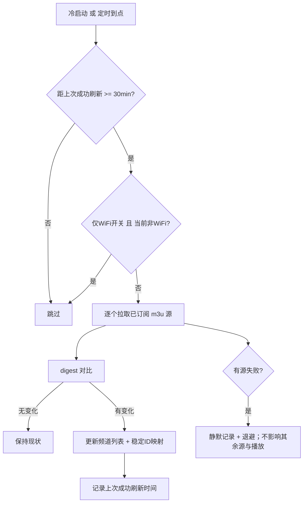
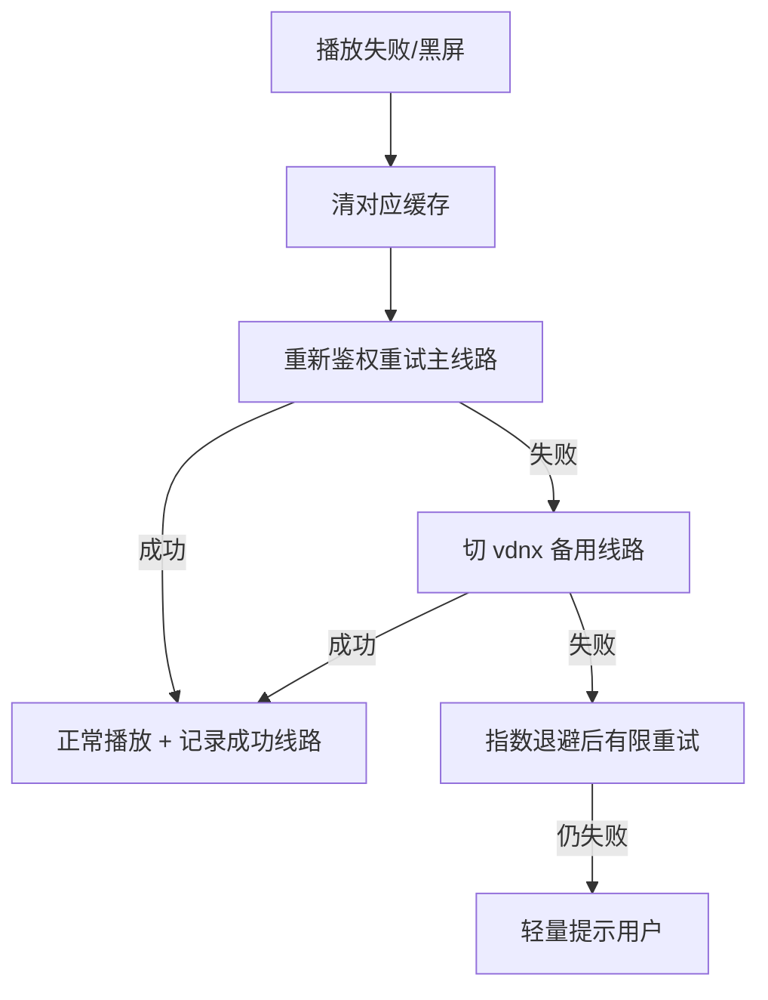
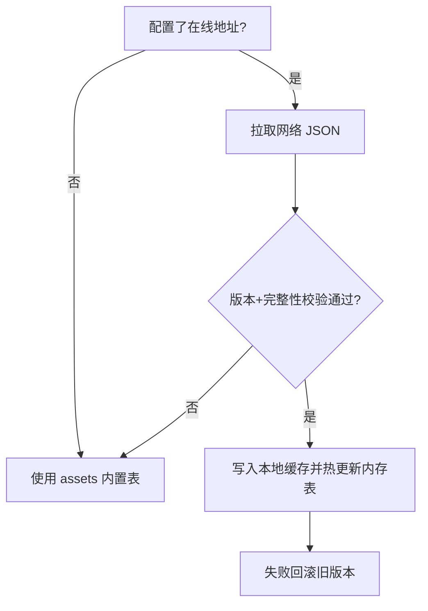

# PRD：OneTV Live 信号源自动更新

> 文档类型：简单 PRD ｜ 作者：许清楚（产品经理）｜ 语言：中文
> 适用工程：`onetv-live-apk`（独立 Android TV 直播 APK，包名 `com.onetv.live`）

---

## 一、项目信息

| 项 | 内容 |
|---|---|
| Language | 中文 |
| Programming Language | Android 原生（Kotlin/Java），基于现有 `com.onetv.live` 工程迭代；非 Web 前端项目 |
| Project Name | `onetv_live_signal_auto_update` |
| 目标用户 | 在 Android TV / 盒子 / 投影上看直播、用遥控器操作的用户 |
| 原始需求 | 为独立直播 APK 做"信号源自动更新"全套能力：A 订阅源自动刷新、B 内置央视频道表在线更新、C 播放失效自动恢复。三项全部实现。 |

### 背景与代码现状（产品侧理解）

| 链路 | 现状 | 痛点 |
|---|---|---|
| A 用户订阅 m3u 源 | `subscribe(url)` 联网拉取 + digest 对比，内容变才更新；**仅手动点订阅时触发**，无定时器；最多 10 源 | 源频道增减用户无感知，须手动重订阅 |
| B 内置央视频道表 | 约 55 个 CCTV/卫视，静态打包在 assets `yangshipin-channels.json`，解析后内存缓存，注释明确"进程运行期间不变" | 央视新增/下架频道只能重装新 APK |
| C 播放流地址 | 播放时联网调央视频 player-api 鉴权 + vdnx 备用线路，有内存/磁盘缓存与线路记忆，但签名/流失效自动恢复弱 | 打不开/黑屏时需手动反复切换 |

---

## 二、产品定义

### 2.1 产品目标（Product Goals，正交）

1. **内容时效**：用户无需手动操作，即可获得最新的订阅频道与央视/卫视频道列表。
2. **播放稳定**：流地址或签名失效时自动恢复，减少手动干预，提升"打开即能看"的成功率。
3. **无感体验**：更新在后台静默完成，不打断观看、不频繁打扰，失败可追溯。

### 2.2 用户故事（User Stories）

1. As a 直播观众，I want 我订阅的 m3u 源在后台自动更新频道，so that 我不用每次手动点订阅也能看到最新频道。
2. As a 长期开机的 TV 用户，I want 即使不重启 App 也能定期刷新频道，so that 频道变更不会滞后几周。
3. As a 电视观众，I want 央视新增/下架频道后 App 能在线更新列表，so that 我不用 reinstall APK。
4. As a 遇到黑屏的用户，I want App 自动清缓存重新鉴权并切备用线路，so that 我能接着看节目而不用反复手动切换。
5. As a 注重流量的用户，I want 能控制自动刷新的网络条件与频率，so that 我不用担心额外流量消耗。

---

## 三、关键产品决策（重点思考项）

### 3.1 刷新时机与策略（问题 1）

**结论：采用「冷启动触发 + 定时周期触发（默认 6 小时，可配置）」组合；不采用「仅冷启动」。**

| 维度 | 决策 | 理由 |
|---|---|---|
| 冷启动 | App 进程真正冷启动时触发一次全量刷新（订阅源；频道表在地址确认后纳入） | 覆盖用户主动使用前的更新窗口 |
| 定时周期 | 前台服务 + 系统闹钟，`setInexactRepeating` 默认每 6 小时，可配置 6/12/24h/仅手动 | TV 长期开机、重启频率低，仅冷启动会导致更新滞后数周 |
| 网络约束 | 不强制 WiFi（TV 多为 WiFi/有线），但提供「仅 WiFi 自动刷新」开关，默认开 | 兼顾流量计费的少数场景与用户自主权 |
| 休眠唤醒 | 闹钟 inexact、短任务（单次超时约 10s），不长期持锁；doze 下允许系统批处理延迟 | TV 休眠为常态，避免耗电与唤醒开销 |
| 触发去重 | 以"上次成功刷新时间"节流，30 分钟内不重复触发 | 冷启动与定时窗口重叠时避免重复请求，减轻源站压力 |

> 不使用后台常驻轮询；不使用精确闹钟；不在播放中触发重建型刷新。

### 3.2 在线频道表托管地址（问题 2 —— 最高优先级待确认项）

**B 需求必须有一个公网可访问、稳定、可更新的 JSON 地址。当前不存在已确认的可用地址，不可假设。**

给出三个候选方案（按推荐顺序）：

| 方案 | 说明 | 优点 | 风险 |
|---|---|---|---|
| ① 内置 + 预留配置项（推荐先落地） | 设置页预留"频道表在线地址"输入项，默认空；为空时只用 assets 兜底 | 不阻塞 A/C 开发，架构先就绪，地址后续填 | 上线初期无在线更新能力 |
| ② 用户提供自建 CDN / GitHub Raw（推荐长期） | 由项目方自有可控地址托管，便于版本管理与稳定性 SLA | 可控、可靠、可审计 | 需项目方提供 URL 与维护承诺 |
| ③ 复用上游开源 OneTV 频道表地址 | 直接引用上游项目公开地址 | 接入快 | 须先核实地址真实存在、可公网访问、更新频率与授权合规；不可想当然 |

**需 team-lead / 用户确认**：确切 URL、授权与可用性、更新频率承诺、JSON 结构/版本字段约定（结构由架构师细化）。

### 3.3 用户体验（问题 3）

- **默认后台静默**：更新不在播放中弹窗、不抢焦点（遥控器用户视线在电视上）。
- **变化提示（轻量）**：频道数变化时在设置页展示"上次更新时间 / 频道数变化"；首页仅角落短暂角标（数秒消失，不遮挡内容）。
- **失败表现（克制）**：静默记录日志与状态；仅在连续失败 N 次（建议 3 次）后，于设置页显示"更新异常"，不在播放中打断。
- **主动入口**：设置页提供"立即检查更新"按钮，满足用户主动触发。
- **恢复中反馈**：播放恢复时显示轻量"正在重试…"，恢复失败才给出明确提示。

### 3.4 风险与边界（问题 4 —— 产品处理原则）

| 风险 | 产品处理原则 |
|---|---|
| 流量消耗 | 「仅 WiFi 刷新」开关默认开；单次刷新限时/限量；30 分钟节流去重 |
| 订阅源服务器压力 | 刷新间隔设下限（不高于每 6 小时一次）；失败指数退避；遵守源站更新节奏 |
| 刷新打断播放 | 刷新与播放解耦：只更新元数据，不重建正在播放的实例；播放中发生的列表变更延迟到下次进入列表页生效；当前频道被删时延后处理 |
| 频道 ID 变化致收藏失效 | **频道用稳定标识（名称/源行 hash），禁止用数组下标做 ID**；ID 变更时按名称做继承映射；无法映射的收藏保留为孤儿不直接删除 |
| 在线表错误/损坏 | 版本校验 + 完整性校验失败即回退 assets 兜底，灰度切换，绝不因更新导致频道不可用 |

### 3.5 优先级（问题 5）

| 优先级 | 需求 | 理由 |
|---|---|---|
| **P0** | A 订阅源自动刷新 | 价值高、技术风险低（已有 digest/存储/联网逻辑，仅缺调度器）、无外部依赖，ROI 最高 |
| **P1** | C 播放失效自动恢复 | 直击核心体验"能不能看"，无外部依赖；技术风险中等（缓存清理、鉴权重试、线路记忆），可基于现有 `PlaybackAttempts/PlaybackRoutes` 收敛 |
| **P2** | B 内置央视频道表在线更新 | 价值高但依赖**未决的托管地址**，且改造面最大（静态缓存→热更新，需缓存/兜底/校验），风险最高；架构先预留配置项，地址确认后立即提级 |

> 三项用户均要求实现；P0/P1/P2 是交付顺序与资源倾斜，不代表取舍。

---

## 四、技术规范

### 4.1 需求池（Requirements Pool）

#### P0 — Must have（订阅源自动刷新）

- **R-A1**：App 冷启动时自动重拉全部已订阅（≤10）m3u 地址。
- **R-A2**：定时（默认 6h，可配 6/12/24h）自动重拉订阅源。
- **R-A3**：沿用 digest 对比，内容无变化不改动频道列表；有变化才更新，并更新"上次成功刷新时间"。
- **R-A4**：刷新节流——上次成功刷新 30 分钟内不重复触发。
- **R-A5**：刷新与播放解耦——元数据更新不得中断正在播放的流；播放中的列表变更延迟生效。
- **R-A6**：频道使用稳定标识（禁止数组下标做 ID），避免更新导致收藏错位。
- **R-A7**：任一源刷新失败不影响其余源与现有频道，播放不受影响。

#### P1 — Should have（播放失效自动恢复 + 体验与可控性）

- **R-C1**：播放失败/黑屏时自动清对应缓存并重新鉴权重试。
- **R-C2**：主线路失败自动切换 CCTV vdnx 备用线路，保留线路记忆。
- **R-C3**：连续失败采用指数退避，避免频繁请求源站。
- **R-U1**：设置页展示刷新状态（上次更新时间、频道数变化、连续失败提示）。
- **R-U2**：设置页提供"立即检查更新"手动入口。
- **R-U3**：提供「仅 WiFi 自动刷新」开关（默认开）与刷新频率配置。
- **R-U4**：变化角标 / 失败克制的提示策略（见 3.3）。

#### P2 — Nice to have（内置频道表在线更新，依赖托管地址确认）

- **R-B1**：频道表支持从网络 JSON 拉取最新版，本地缓存 + assets 兜底。
- **R-B2**：版本/完整性校验，失败回退旧版本或 assets，不影响播放。
- **R-B3**：设置页提供"频道表在线地址"配置入口，空则用内置表。
- **R-B4**：收藏/频道 ID 变更的继承迁移策略落地（承接 R-A6）。

### 4.2 UI 设计草稿（UI Design Draft）

- **设置页新增分组「信号源与更新」**：
  - 自动刷新 开/关
  - 刷新频率选择：6h / 12h / 24h / 仅手动
  - 仅 WiFi 自动刷新 开/关（默认开）
  - 「频道表在线地址」输入项（P2，可留空）
  - 状态区：上次更新时间、频道数变化、更新状态（正常/连续失败）
  - 按钮：「立即检查更新」
- **首页频道列表**：更新有变化时出现短暂角标（数秒消失，不遮挡、不抢焦点）。
- **播放层**：恢复过程轻量"正在重试…"，恢复失败才明确提示。
- **交互原则**：遥控器可达、焦点清晰、无强制弹窗。

### 4.3 关键流程（Key Flows）

**流程一：定时/冷启动刷新订阅源（P0）**

**流程二：播放失效自动恢复（P1）**

**流程三：内置频道表在线更新（P2）**

### 4.4 可衡量验收标准（摘要）

- 冷启动/定时触发后，订阅源在 10 秒内完成一次刷新尝试（超时即放弃，不影响启动）。
- 内容无变化时频道列表零改动（digest 命中）。
- 30 分钟内多次触发仅生效一次。
- 播放失效恢复成功率与主线路可用性分别可统计（供后续评估）。
- 在线表校验失败 100% 回退 assets，不出现空列表。

---

## 五、待确认问题（Open Questions）

| # | 问题 | 影响 | 建议/默认 | 需谁确认 |
|---|---|---|---|---|
| 1 | **频道表在线 JSON 的确切托管地址是什么？** | 阻塞 B 的全部实现 | 先按"内置 + 预留配置项"落地；长期用自建 CDN/GitHub Raw；如复用上游地址须先核实存在性/稳定性/授权 | **team-lead / 用户（最高优先）** |
| 2 | 定时周期默认值 6h 是否合适？ | 影响刷新策略与源站压力 | 默认 6h，可配 6/12/24h/仅手动 | team-lead |
| 3 | 订阅源数量/单源大小/超时上限具体阈值？ | 影响流量与稳定性 | 沿用现有 ≤10 源；单源大小与超时取保守值（约 10s） | 架构师 |
| 4 | 「仅 WiFi 刷新」默认值？ | 影响流量与用户体验 | 默认开 | team-lead |
| 5 | 频道表 JSON 的结构、版本字段、校验方式？ | 影响 B 的缓存与回滚设计 | 由架构师定义，产品要求含版本号与可校验字段 | 架构师 |
| 6 | C 的技术前提：签名失效后是否有从 so 内核重新取签名的可靠路径？ | 决定 C 的可行性与方案 | 需架构师评估；若不可行，C 退化为"清缓存 + 切备用线路 + 有限重试" | 架构师 |

> 备注：问题 1 是唯一硬阻塞项（B 上线前置）；其余不阻塞 A/C 启动。
